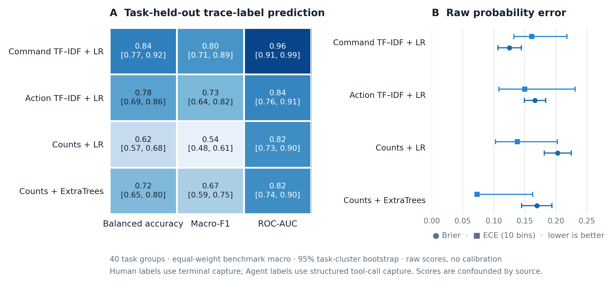
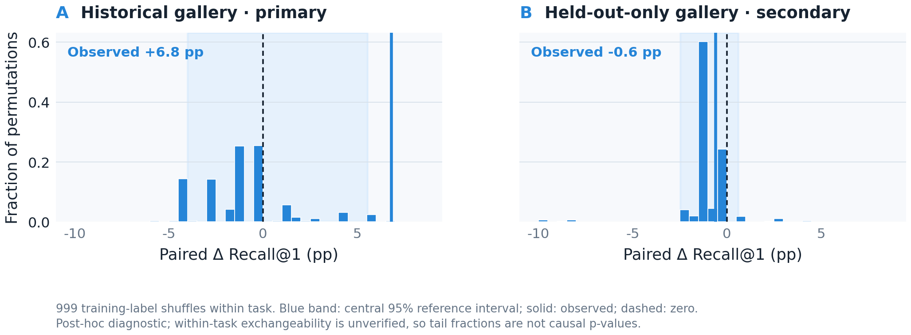

# 跨基准行为关联原型与实验结果

> 状态：公开数据上的事后探索性实验，不是预注册确认性研究。数据目标为 CTF 题目检索，不是攻击活动或 APT 组织归因。

## 要回答的问题

本轮把研究叙事压缩为一个可检验问题：在同一基准的不同题目作为困难负例时，人类轨迹能否检索到同题 Agent 轨迹？在此基础上，折外估计的执行模式分数能否改善同题关联排序？如果不能稳定改善，就不能声称“先识别 Agent 即可恢复关联”。

实验采用 [Lyptus Offensive Cybersecurity Time Horizons 数据发布](https://github.com/lyptus-research/cyber-task-horizons-data) 的固定版本 `178c0da1800f9c07311e1b8d6c61dd8104e7b4ae`，数据许可为 CC BY 4.0。新增 CyBench、NYUCTF 轨迹与既有 InterCode-CTF 合并后，筛出 177 条可解析非空轨迹、40 个同基准同题交集：InterCode-CTF 27 题、CyBench 6 题、NYUCTF 7 题；其中人类 57 条、Agent 120 条。每题整体留在同一折，五折外层划分；检索候选始终来自同一基准，正例为同一题 ID，负例为同基准的其他题。

### 数据与题目从哪里来

[Cyber Task Horizons](https://lyptusresearch.org/research/offensive-cyber-time-horizons) 是一个公开的攻击性网络安全任务评估数据发布，汇集七套基准的模型评估轨迹，并发布了十位网络安全专业人员参与、覆盖 291 个任务的人类研究数据。原研究让专家和模型在相同的 Docker 任务容器中工作；专家通过终端交互，平台保存终端输入与输出，模型则以结构化工具调用记录命令和工具反馈。我们使用的是这个发布中的**公开题目解题轨迹**，不是企业端点遥测、真实入侵记录或 APT 案例日志。

三套基准的题目来源各不相同：

| 基准 | 题目原始来源与任务形式 | 本实验保留的同题组 | 人类轨迹 | Agent 轨迹 |
|---|---|---:|---:|---:|
| [InterCode-CTF](https://papers.nips.cc/paper_files/paper/2023/file/4b175d846fb008d540d233c188379ff9-Paper-Datasets_and_Benchmarks.pdf) | 以 PicoCTF 为来源的 100 个交互式 CTF 任务。每题由指令、附件/素材和隐藏 flag 构成；本实验交集来自 general-skills 与 reverse 任务。 | 27 | 40 | 81 |
| [CyBench](https://arxiv.org/abs/2408.08926) | 来自四项竞赛的 40 个专业级 CTF 挑战，包含题目描述、初始文件和可交互环境。 | 6 | 8 | 18 |
| [NYU CTF Bench](https://proceedings.neurips.cc/paper_files/paper/2024/hash/69d97a6493fbf016fff0a751f253ad18-Abstract-Datasets_and_Benchmarks_Track.html) | 从多个知名 CTF 竞赛整理而成的多类挑战题及其 Agent 评测记录。 | 7 | 9 | 21 |
| **合计** | 三套基准中同时有人类和 Agent 记录、且解析后至少有一个命令的任务交集。 | **40** | **57** | **120** |

数据从上述发布的固定提交获取，清单保存每个来源文件的路径、字节数与 SHA-256。对带日期的 Agent 评测文件，按基准、模型和任务保留最新一次；无日期的任务使用完整评测文件。人类记录解析自 `.input` 终端事件，Agent 记录解析自 `bash` 工具调用参数；统一提取允许列表中的命令名，并映射到粗粒度动作类别。主特征不使用提示词、题目文本、工具输出、答案、模型名、时间戳或文件路径；筛选后的 Agent 轨迹中 300 次 Python 工具调用也不纳入主表示。原始轨迹保留在本地忽略目录，不随仓库分发。

实验中的正例标签是同一 `benchmark/task_id`，负例是同一基准中的其他题目。它让我们能在相同题目背景下比较记录并检索题目，却不表示两条轨迹来自同一操作者、攻击活动或 campaign。采集界面也与记录类别绑定：人类是终端输入，Agent 是结构化工具调用；因此，当前分类结果衡量发布内两种记录来源的可分性，不是对未知真实日志的通用 Agent 识别准确率。人类受试者被要求不使用 AI，但该远程研究不能独立核验每条会话是否完全无 AI 辅助。

固定版本、题目交集及逐文件哈希见 [`data/manifests/`](data/manifests/)，解析后任务清单与样本计数见 [`results/crossbenchmark_exploration.json`](results/crossbenchmark_exploration.json)。

## 原型

原型是一个两头基线，可从 `attackagent.prototype` 使用。输入为已规范化的有序命令和动作记录，另需训练标签；第一头输出 `agent_like_score`，第二头输出相似度关联排序分数。

| 部件 | 当前实现 |
|---|---|
| 执行模式头 | 命令 unigram/bigram TF-IDF + 类别平衡逻辑回归；训练时只支持 `human`、`agent` 两类 |
| 关联基线 | 命令 unigram 余弦与有序粗粒度动作 bigram 余弦，经平衡配对逻辑回归得到排序分数 |
| 模式感知关联 | 在两种相似度上加入折外模式概率、两端概率差及其交互项，再拟合配对排序器 |
| 正负例 | 正例同基准同题；负例同基准异题；按题目和人—人、人—Agent、跨来源 Agent—Agent 配对抽样 |
| 切分 | 五折按题目留出；关联训练用的模式分数在外层训练集内再次按题目折外生成 |
| 输出边界 | 分数只用于候选排序；不是现实活动同源概率。`script` 类无标签数据，原型明确不支持该类别 |

配对样本按 1:1 抽样，因此 `predict_proba` 的数值不代表现实先验概率；原型不提供可部署的通用阈值。测试中的 oracle 对照会直接使用已知模式标签，只是诊断上限，不是可用模型。

## 检索结果

主指标是按独立题目聚合、再对三个基准等权宏平均的 Recall@1、MRR 和查询级 AUC。区间由基准分层、题目簇重采样 5,000 次得到。随机 Recall@1 为候选题数倒数，三基准宏平均为 0.116。

| Human → Agent 方法 | Recall@1（95% 题目簇 CI） | MRR | 查询 AUC | 解释 |
|---|---:|---:|---:|---|
| 命令 unigram 余弦 | 0.347 [0.165, 0.536] | 0.518 | 0.740 | 可检索同题，但区间宽 |
| 有序命令 bigram | 0.265 [0.105, 0.444] | 0.459 | 0.685 | 此表示低于命令集合 |
| 有序动作 bigram | 0.414 [0.245, 0.576] | 0.561 | 0.733 | 点估计最高；不同基准表现不齐 |
| ProcGrep 局部程序模式 | 0.287 [0.123, 0.451] | 0.484 | 0.706 | 在该解析器与数据上没有胜过简单动作序列 |
| 原型：相似度配对排序 | 0.346 [0.175, 0.521] | 0.538 | 0.760 | 两种相似度的监督融合 |
| 原型：加入折外模式分数 | 0.414 [0.231, 0.597] | 0.577 | 0.775 | 点估计上升，但增量区间跨零 |
| 原型：真实模式标签 | 0.346 [0.170, 0.527] | 0.538 | 0.759 | 非部署对照；Human→Agent 本身已知为跨模式 |

`crossbenchmark_human_to_agent_retrieval` 图展示每个基准的表示比较；[原型增量图](results/figures/mode_aware_association_delta.png)展示加入模式分数相对相似度排序器的任务配对变化。CyBench、InterCode-CTF、NYUCTF 的模式感知 Recall@1 分别为 0.500、0.241、0.500，对应随机基线 0.167、0.037、0.143。三者样本很少，不能从其中挑一个最好看的子集作为主结论。

| 查询方向 | 加入折外模式分数后 Δ Recall@1（95% 题目簇 CI） | 独立题目数 | 含义 |
|---|---:|---:|---|
| Human → Agent | +0.068 [-0.012, +0.191] | 40 | 有正向趋势，但未形成稳定增益证据 |
| Agent → Agent（跨模型） | +0.012 [-0.016, +0.051] | 40 | 接近无变化 |
| Agent → Human | +0.024 [-0.012, +0.068] | 40 | 方向不确定 |
| Human → Human | −0.098 [-0.189, −0.007] | 17 | 本样本内出现下降，提示模式校准可能伤害同模式检索 |

MRR 与查询 AUC 的增量也未显示 Human→Agent 的明确提升：MRR `+0.039 [-0.006, +0.100]`，AUC `+0.015 [-0.005, +0.040]`。Human→Human 的指标下降值得作为风险信号报告，但 17 个题目、混杂采集方式不足以支持一般性结论。

独立的参与方式分类基线达到 balanced accuracy `0.863 [0.804, 0.915]`、Macro-F1 `0.854`、ROC-AUC `0.945 [0.917, 0.972]`。只用命令数量和动作比例也达到 BAcc `0.650`、AUC `0.728`；仅基准名负控 AUC `0.501`。这些数值与论文结果表采用同一组逐轨迹折外预测。类别与采集流程完全绑定：人类是终端录制，Agent 是工具调用日志。因此高分只能说明此发布中的两类记录可分，不能解释为识别真实操作者或决策主体。

## 对论文叙事的直接结论

本轮结果**没有证明 Agent 参与会使活动关联失效，也没有证明识别后恢复了关联**。Human→Agent 同题检索在三个基准均高于各自随机排序，且其总体表现与 Agent 跨模型检索同处相近区间。加入模式概率后的 Human→Agent 点估计提高约 0.07，但任务配对区间跨零；真实模式标签对照也未改善该方向；同一原型在 Human→Human 检索上反而下降。

因此，当前最可靠的论文定位是：提出并测试一个“执行模式是否为行为关联提供增量信息”的基线问题；公开数据给出方向不稳定的初步结果，同时暴露出标签—采集模态混杂和缺少脚本类对照。若把“Agent 已导致 APT 关联错误”写成既定事实，证据不够。更准确的写法是“该风险尚待共同遥测、独立活动真值的受控实验验证”。

## 特征特异性与候选库复核

在固定的五折、任务配对和 `C=0.5` 参数下，新增两个非模式对照：将 11 维模式分数特征换成仅由外层训练任务拟合的命令数量经验分位数；以及 6 维非线性相似度特征。另在同一组查询上，将候选库严格限制为外层留出任务。运行前未调整方法以追逐测试结果。

| Human→Agent 协议 | 排序器 | Recall@1（95% 任务簇区间） | 任务数 | 平均候选数 |
|---|---|---:|---:|---:|
| 历史候选库 | 相似度基线 | 0.346 [0.175, 0.528] | 40 | 13.3 |
| 历史候选库 | 预测模式分数 | 0.414 [0.232, 0.596] | 40 | 13.3 |
| 历史候选库 | 命令数量对照 | 0.431 [0.243, 0.615] | 40 | 13.3 |
| 历史候选库 | 非线性相似度 | 0.369 [0.188, 0.551] | 40 | 13.3 |
| 仅留出题目候选 | 相似度基线 | 0.638 [0.473, 0.787] | 36 | 4.1 |
| 仅留出题目候选 | 预测模式分数 | 0.632 [0.470, 0.781] | 36 | 4.1 |
| 仅留出题目候选 | 命令数量对照 | 0.680 [0.507, 0.821] | 36 | 4.1 |
| 仅留出题目候选 | 非线性相似度 | 0.680 [0.502, 0.819] | 36 | 4.1 |

| 配对差值（前者减后者） | 历史候选库 Δ Recall@1（95% 区间） | 仅留出题目候选 Δ Recall@1（95% 区间） |
|---|---:|---:|
| 模式 − 相似度 | +0.068 [−0.012, +0.191] | −0.006 [−0.019, 0.000] |
| 数量 − 相似度 | +0.086 [−0.006, +0.213] | +0.042 [−0.025, +0.127] |
| 非线性 − 相似度 | +0.024 [0.000, +0.071] | +0.042 [0.000, +0.125] |
| 模式 − 数量 | −0.018 [−0.071, +0.025] | −0.048 [−0.131, +0.025] |

**结论收紧：** 历史候选库中，模式分数没有胜过命令数量对照（模式减数量 −0.018，区间跨零）；仅用留出任务构建候选库时，模式分数相对相似度基线的点差为 −0.006。当前未观察到特异于模式监督的关联增益。由于标签与采集方式仍绑定，这不是证明模式信息普遍无用，而是说明现有数据不能把观察到的点估计归因于执行方式识别。

两个候选库协议的绝对 Recall@1 不直接可比：平均候选数由 13.3 降至 4.1，随机基线相应由 0.116 升至 0.278。95% 区间按基准内任务簇重采样，并以三个基准等权宏平均；它们以拟合出的折和固定候选集为条件，没有覆盖重新拟合或候选抽样的不确定性。全部机器可读结果见 [`results/specificity_controls.json`](results/specificity_controls.json)，复现实验见 [`scripts/run_specificity_controls.py`](scripts/run_specificity_controls.py)，图由 [`scripts/generate_paper_figures.py`](scripts/generate_paper_figures.py) 生成。

**可用于初稿的结果段：**

> 我们在三个公开网络安全挑战基准上构建了按题目分组的五折检索实验，共包含 40 个同题人类—Agent 任务组。以同一基准内其他题目作为困难负例时，人类轨迹到 Agent 轨迹的命令 unigram 基线取得 0.347 的宏平均 Recall@1（95% 题目簇区间 [0.165, 0.536]），高于宏平均随机基线 0.116。加入按题目折外预测的执行模式分数后，Recall@1 点估计升至 0.414，但配对增量为 +0.068（95% 区间 [−0.012, 0.191]），未能确立稳定收益；同一方法在 Human→Human 检索上呈负向变化。由于人类终端记录和 Agent 工具调用记录来自不同采集路径，且题目 ID 不代表活动同源标签，这些结果仅说明模式条件化值得进一步受控检验，不能证明真实攻击活动关联已受损或得到修复。

## 如何复现

在仓库根目录运行：

```bash
.venv/bin/python scripts/download_public_traces.py
.venv/bin/python scripts/download_crossbenchmark_traces.py
.venv/bin/python scripts/run_crossbenchmark_experiments.py
.venv/bin/python scripts/run_mode_aware_association.py
.venv/bin/python scripts/run_specificity_controls.py
.venv/bin/python scripts/compare_trace_mode_models.py
.venv/bin/python scripts/run_mode_label_permutation.py --permutations 999 --seed 20262701
.venv/bin/python -m unittest discover -s tests -v
```

Notebook [`notebooks/02_mode_aware_association.ipynb`](notebooks/02_mode_aware_association.ipynb) 读取聚合结果、执行切分检查并生成表格；命令行脚本重算实际模型和区间。新增的 [`notebooks/03_specificity_controls.ipynb`](notebooks/03_specificity_controls.ipynb) 会重跑本节的特异性与候选库对照，核对原 274 条结果，并直接展示完整指标表、配对差值和图。Notebook 与 `scripts/run_specificity_controls.py` 使用同一份实验实现。

使用留出任务演示原型接口：

```bash
.venv/bin/python scripts/demo_mode_aware_association.py
```

### 本地分类器比较与条件置换复核

对 177 条记录、40 个任务组追加了等任务权重、等基准权重的模型比较。按 `benchmark/task_id` 做五折 GroupKFold，并对固定折外预测做 5,000 次任务簇 bootstrap。命令 TF-IDF + 逻辑回归在四个 CPU 基线中平衡准确率最高（0.844 [0.766, 0.915]），ExtraTrees 在 Brier（0.169）和 10-bin ECE（0.073）的点估计中分别表现更好；没有模型经过独立概率校准。该结果使用任务宏平均，和前文按记录汇总的 0.863 不是同一估计量，不能直接作差。

| 模型（任务宏平均） | BAcc（95% CI） | Macro-F1（95% CI） | ROC-AUC（95% CI） | Brier | ECE-10 |
|---|---:|---:|---:|---:|---:|
| 命令名 TF-IDF + LR | 0.844 [0.766, 0.915] | 0.804 [0.709, 0.892] | 0.957 [0.914, 0.992] | 0.125 | 0.161 |
| 动作类别 TF-IDF + LR | 0.777 [0.692, 0.855] | 0.729 [0.638, 0.820] | 0.835 [0.757, 0.911] | 0.166 | 0.150 |
| 命令数/动作比例 + LR | 0.622 [0.569, 0.683] | 0.537 [0.477, 0.609] | 0.819 [0.734, 0.900] | 0.203 | 0.138 |
| 命令数/动作比例 + ExtraTrees | 0.723 [0.654, 0.797] | 0.668 [0.593, 0.751] | 0.819 [0.738, 0.895] | 0.169 | 0.073 |



另外固定任务内模式标签占比，在训练折内做了 999 次条件置换，并逐次重拟合模式头和关联排序器。历史候选库的真实标签增量 +6.8 pp，高于 999 次置换中的 994 次；仅留出任务候选库的增量为 −0.6 pp，置换中有 323 次不低于观察值。前者是事后条件分布诊断，不是因果检验或有效显著性检验：人/Agent 标签与采集模态完全重合，且任务内标签交换性未由设计保证。两种候选库结论方向不同，不支持稳定的执行方式增益。



Jev Choice 与 OpenAI Decisions 的 API 比较未运行：没有 API 凭证或可核验免费额度，也未产生付费请求。官方文档说明二者都提供选项概率与单独的 confidence；这些字段必须分别校准和评估。预训练语义模型因本地无缓存权重和推理运行时也未运行。来源审计、协议和 API 状态见[公开数据与模型对比](08-公开数据与模型对比.md)。

JSONL 原型入口现在可从 `train.jsonl`、`queries.jsonl` 和 `candidates.jsonl` 读取规范化记录，输出类别得分、证据计数、拒判原因与同基准候选排序。`examples/jsonl/` 中数据仅用于接口 smoke 示例，不是测评样本；脚本类会拒判，因为当前训练数据没有 script 标签。分数未校准，也不代表现实 APT 或活动同源概率。

核心产物为 [`results/crossbenchmark_exploration.json`](results/crossbenchmark_exploration.json)、[`results/mode_aware_association.json`](results/mode_aware_association.json)、逐题 CSV 与 figures 目录。原始轨迹不进 Git。

## 下一项决定性实验

需要在隔离靶场对相同任务重复采集纯人工、固定脚本、人工监督 Agent、目标驱动 Agent；所有条件使用相同外部主机/网络遥测、任务快照和采集栈。由独立于行为特征的流程标记执行方式，并以独立的活动 ID 构造同源/异源候选。按活动、操作者和任务留出，先检验参与识别校准，再比较不含模式信息与含预测模式信息的误拆分、误合并及活动检索表现。没有这组对照前，不应将当前 CTF 检索推进为 APT 因果结论。
