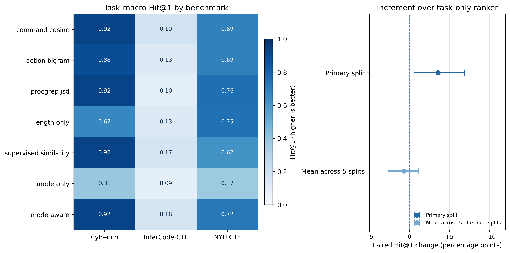
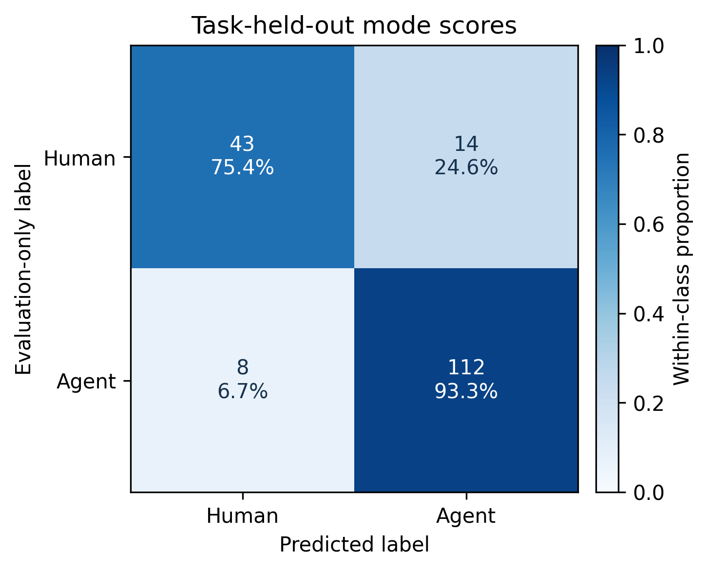
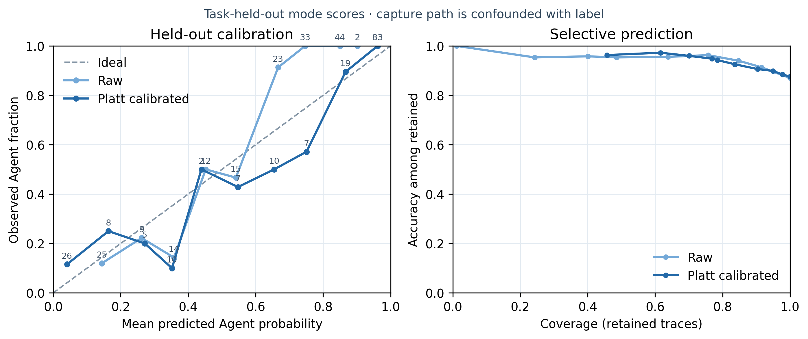

# 行为关联中的执行来源：文献、数据与初步实验

> 更新：2026-10-30。项目是开放研究库：本文献表记录外部工作，实验脚本记录可复现适配与本项目基线。当前结果来自公开 CTF 轨迹，只能回答同题轨迹检索问题。

## 研究问题

攻击事件、告警和主机轨迹的关联研究确实存在多年，且一部分方法显式使用命令/操作、TTP、事件序列、实体关系或因果信息。实务框架也先把观测活动作为 cluster 持续积累，再判断它是否属于临时或具名威胁组织。由此可以正向提出一个研究问题：**在行为证据被用于连接攻击活动时，执行方式（人、固定脚本、LLM Agent）是否会改变这类证据的相似性或因果结构？若会，在可见日志中识别执行方式，能否改善活动候选的排序或减少误连？**

这是一条待检验链条，不预设关联器已经失效。组织归因仍是后续推断，本研究把可检验落点放在活动关联。具体风险假设是：相同活动若由不同方式执行，低层操作表示可能不同而被拆开；不同活动若共享同一执行系统或模板，也可能因操作模式相近而被合并。ATT&CK/TTP 归一化、稳定实体关系和因果图也可能削弱这种差异，因此应把这些方法作为竞争解释或对照，而不是预设行为变化必然伤害关联。

## 关联阶段是否真实存在，行为证据是否真实被用到？

**存在，但不是所有系统都实现为一条固定的“APT 关联阶段”。** 学术文献覆盖安全事件/告警关联、跨主机行为关联、攻击故事重建、CTI 与日志匹配等相邻任务；论文目标不同，不能把故事重建、已知攻击搜寻、活动聚类和组织归因混为一个标签。Unit 42 的公开流程把 Activity Clusters、Temporary Threat Groups 和 Named Threat Actors 区分开；Microsoft 也用临时的活动集群跟踪尚未高置信归属的活动。这支持“先整理/关联可观察活动，再逐步判断主体”的分析实践，但不代表所有机构采用相同流水线。

执行方式也已进入公开攻击活动记录：Anthropic 对 2025 年网络间谍活动的报告描述了人类操作员通过 Claude Code 与 MCP 工具编排多阶段操作；MITRE 后续将相关活动登记为 Campaign C0062，并记录 Claude Code Agent 参与。这个案例说明执行来源是理解攻击过程的一项现实上下文，但单个案例既不能证明现有行为关联算法因此出错，也不提供可公开复跑的端点日志。研究动机因此由两类独立证据构成：关联系统确实使用行为证据，现实活动也开始包含 Agent 执行；两者之间是否产生测量与关联误差仍需实验。

| 工作 | 关联对象与行为证据 | 数据与方法 | 能支持什么 / 不能支持什么 |
|---|---|---|---|
| [Security Event Correlation Methods 系统综述（IEEE Access 2022）](https://doi.org/10.1109/ACCESS.2022.3168976) | 127 篇安全事件关联工作；归纳相似度、步骤序列和混合方法，并比较数据集与指标。 | 系统综述，不是单一算法或单一数据集。 | 证明事件/告警关联是成熟研究主题；不证明每篇研究都在做跨 campaign 身份匹配。 |
| [HOLMES（IEEE S&P 2019）](https://www.seclab.cs.sunysb.edu/seclab/pubs/holmes19.pdf) | 从 Linux auditd、ETW 等主机审计数据构建高层 Kill Chain/TTP 行为图，以信息流和可疑事件关系关联跨主机的攻击步骤，形成 campaign 信号。 | DARPA TC 红蓝演练及报告驱动场景；论文报告多个现实 APT 案例分析。 | 直接支持“低层审计行为和因果关系可用于 campaign 级关联/解释”。评估没有按人、脚本、Agent 执行标签分层。 |
| [OSTINATO（arXiv 2023）](https://arxiv.org/abs/2312.09321) | 将审计事件和 TTP 标签组成 provenance graph，比较进程/实体及边的行为相似度，寻找不同主机上的相似活动。 | DARPA 红队数据覆盖 500 台 Windows 主机，以及另一多主机多系统场景；作者报告额外发现 21 台受感染主机，并将底层 IDS 告警减少 90% 以上。 | 是“行为相似性用于跨主机活动扩展”的直接例子。没有比较同一攻击在不同执行方式下的关联错误。 |
| [POIROT（ACM CCS 2019）](https://arxiv.org/abs/1910.00056) | 把 CTI 报告中的攻击实体/关系图与由内核审计日志建成的 provenance graph 做近似图对齐。 | DARPA TC 多平台十个攻击场景及公开现实事件报告。 | 证明操作关系、实体类型和因果依赖可用于威胁搜寻。目标是“情报描述能否在日志中找到”，不是人/Agent 识别或开放式活动身份聚类。 |
| [HERCULE（ACSAC 2016）](https://doi.org/10.1145/2991079.2991122) | 把跨源日志转成加权图，利用社区发现关联事件并重建攻击故事。 | 15 个由威胁报告复现的 APT 家族/攻击场景。 | 证明时间、进程、网络等多源行为关系能支持多步骤调查；分析单位主要是一次攻击故事，不等于跨活动主体归属。 |
| [ATLAS（USENIX Security 2021）](https://www.usenix.org/conference/usenixsecurity21/presentation/alsaheel) | 从因果图构造行为序列，学习攻击与正常操作模式，并从告警起点恢复攻击故事。 | 10 个按真实攻击报告复现的 APT 场景；Windows 审计与背景活动；按攻击实体和事件评估。 | 证明序列和因果上下文能把分散日志组织为调查线索；目标是攻击故事恢复，不含人/脚本/Agent 标签。 |
| [SFM：Technique Hunting and Subgraph Matching（arXiv 2024）](https://arxiv.org/abs/2410.22602) | 从系统事件日志识别 ATT&CK 技术，再与已知 APT campaign 序列/子图匹配。 | 预印本报告五个真实攻击活动场景；数据获取与标签细节以论文方法章节为准。 | 直接把日志证据映射到 campaign 候选；没有执行方式标签，因此不能估计模式变化影响。 |
| [ActMiner（Knowledge-Based Systems 2025）](https://doi.org/10.1016/j.knosys.2025.114169) | 从 CTI 描述构造查询图，与 audit/provenance 图做增量子图对齐，并用攻击因果关系过滤候选。 | DARPA Engagement 与仿真数据；作者报告相较 POIROT 减少 39.1% 误报并消除该测试设置中的漏报。 | 进一步表明因果行为图被直接用于日志威胁搜寻；数值只对应其数据和协议，不能迁移比较，也没有执行来源对照。 |
| [FALCON（UAI 2025）](https://proceedings.mlr.press/v286/tang25a.html) | 跨域离散审计日志构造因果溯源图，以行为序列和预训练表征支持攻击调查及场景重建。 | 面向异构/跨域端点审计日志；作者报告检测与场景重建指标。 | 说明行为与因果上下文仍是新近 APT 调查方法的核心输入；研究任务是检测/重建，不是执行者身份或跨 campaign 归因。 |
| [Unit 42 Attribution Framework](https://unit42.paloaltonetworks.com/unit-42-attribution-framework/)；[Microsoft actor naming](https://learn.microsoft.com/en-us/defender-xdr/microsoft-threat-actor-naming) | 实务中先跟踪 activity cluster，再积累跨事件的 TTP、基础设施、受害者和时间线关系，达到证据门槛后才升级到组织/具名主体。 | 分阶段威胁情报流程，不是可直接复跑的基准算法。 | 支持把活动关联与组织归因分开，并说明活动层结果本身有用；不能证明 Agent 改变关联器准确率。 |

这张表覆盖“事件关联 → 跨主机活动扩展 → 攻击故事恢复 → CTI/日志图匹配 → 活动簇升格归因”几类相邻而不同的任务。共同点是系统把操作序列、TTP、实体关系、信息流或因果边当作证据；区别在于正例标签可能是同一告警链、同一演练活动、同一攻击报告，或已知情报图匹配。后续研究应选择一个明确关联单位，并沿用适合该单位的数据真值，不能把不同论文的“关联”指标直接并表。

**小结：** 用户提出的分析环节有坚实的文献与实践依据，且已有大量相邻方法；更准确的表达不是“所有 APT 识别都先做一个固定关联步骤”，而是“攻击调查与威胁情报常以行为证据把事件、主机或攻击片段连接成活动候选”。研究空白应落在**关联评价是否显式控制/记录执行方式**，而不是泛称“以前没有人区分人和 Agent”。

## 数据能回答到哪里

| 数据源 | 已核对的内容 | 适合的问题 | 不可替代的缺口 |
|---|---|---|---|
| [Cyber Task Horizons](https://github.com/lyptus-research/cyber-task-horizons-data) 固定提交 `178c0da1800f9c07311e1b8d6c61dd8104e7b4ae`，CC BY 4.0 | 三个基准筛得 177 条非空轨迹、40 个同题组：InterCode-CTF 27、CyBench 6、NYUCTF 7；57 条人类终端记录、120 条 Agent 工具调用。 | 用独立题目留出，检查同题行为检索及人类/Agent 记录是否可分。 | 题目 ID 是挑战题代理标签，不是同一攻击活动；终端输入与工具调用采集方式和类别完全绑定；没有脚本组。 |
| [CAM-LDS v2](https://zenodo.org/records/18861762)，CC BY 4.0 | 7 个合成攻击链、34 次场景运行、13 个 ATT&CK tactic、81 个 technique；有 Linux 企业式实验环境的 audit、认证、Web、syslog 等多源日志，AttackMate 提供基于时间的技术标签；归档含步骤/序列/技术视图。上游说明 `sequences` 与 `techniques` 可能因一个步骤多技术而重复，应选 `steps` 视图。 | auditd/多日志解析、攻击步骤与技术关联基线、复现数据接入。 | 数据合成且没有 Human/Script/LLM-Agent 执行标签；可测步骤关联，不能测执行方式的因果作用。本轮未下载 214–536 MB 压缩归档，因此只完成元数据审计，尚未声称跑过 CAM-LDS。 |
| [AIT/AECID LLM User Shell Simulation](https://github.com/ait-aecid/llm-user-shell-sim) | Nextcloud/WordPress 故障排查；包含 audit、syslog、应用日志与人类/AI 参与者。仓库明确描述了处理流程，但没有明确授予数据再使用的许可。 | 未来经许可澄清后，研究统一类型的系统管理行为识别。 | 不是攻击活动；当前不把其数据并入实验，也不据此训练或报告结果。 |
| [SAGA v1](https://saga-tw.github.io/dataset/v1) | 五个由威胁报告改编生成的 APT 活动场景；页面给出攻击步骤、ATT&CK 技术和事件计数。 | 可用于步骤/技术检测和攻击链关联；活动场景有步骤级真值。 | 日志为合成场景，缺少 Human/Script/Agent 执行标签；报告中的 APT 名称表示场景来源，不等于真实遥测。 |
| [ATLAS / ATLASv2](https://arxiv.org/abs/2401.01341) | 复现十种威胁报告驱动的攻击，并加入背景工作站使用、Windows audit、Sysmon、DNS 等遥测。 | 适合攻击故事恢复与多源日志接入；ATLASv2 由两位研究者在实验环境中使用受害主机采集背景行为。 | 没有以统一可见操作日志标注决策来源类别；使用前需核对具体数据版本及其再利用条款。 |
| OpTC / DARPA TC | 红队主机遥测和攻击场景有助行为/因果关联评价。 | 真实主机遥测关联方法复现。 | 公开记录通常没有同任务、同传感器下的人/脚本/Agent 标签；仍需配套受控重复执行。 |

当前没有找到一个可公开复用的数据集同时满足：同一传感器记录、相同任务的人/脚本/Agent 对照、独立活动 ID、可用的关联正负例标签。这个结论限定于上述定向检索和可访问来源，不宣称全网穷尽。CAM-LDS 可帮助把日志工具链接入真实结构的数据，却不能补齐执行来源标签；CTH 可探索行为/模式，却不能替代攻击活动真值。两者不能拼接成一个因果实验。

## 本轮实验：混合候选库中的同题轨迹检索

### 协议

- 数据：177 条轨迹、40 个 benchmark-qualified CTF 任务组；原始轨迹只留在忽略目录，仓库仅保存清单、聚合指标和脚本。
- 外层：按 benchmark 分层的三折任务留出，主种子 `20261030`；同题记录不跨外层训练/测试。另跑五个预先固定的替代划分种子 `20261130` 至 `20261530`。
- 每个测试查询的候选库：同基准外层测试折的全部其他轨迹，保留人类和 Agent 混合候选，不按执行方式筛选；查询自身按 `trace_id` 排除。正例是同基准同题，负例是同基准异题。
- 关联排序训练的正负配对仅从 benchmark/task ID 构造，不使用模式标签、来源或文件名；模式特征来自训练任务内的折外预测。测试推理不接收真值模式。
- 方法：命令 TF–IDF 余弦、动作 bigram、ProcGrep BPE/JSD 适配、仅命令长度、任务标签监督相似排序器、模式单独排序、模式增强排序。ProcGrep 是外部研究的固定版本适配，不是本项目原创方法。
- 主指标：先查询内计分，再对任务等权、基准等权的 Hit@1；补充 MRR、Recall@5、nDCG@5。并列按均匀随机次序计算期望指标。区间为 5,000 次基准分层任务簇 bootstrap，条件于固定折和模型。
- 识别：命令 unigram/bigram TF–IDF + 逻辑回归。仅作为 CTH 记录标签可分性检查；人/Agent 标签与采集接口共线，不能解释成识别真实决策者。

### 与原始预设的差异

[`01-实验预设.md`](01-实验预设.md) 保留了最初的计划，不回写成事后协议。本轮主实验作为独立的 `mixed-gallery-v1` 执行，和初始预设存在以下差异，故报告应视为探索性研究：原计划集中于 InterCode-CTF 和单一任务划分；本轮使用固定版本中三个有人类与 Agent 记录交集的基准，采用基准分层三折任务留出及五个替代划分。原计划拟用同题相似度阈值比较不同模式组；因没有活动级真值、组别样本有限且阈值比较会额外调参，本轮改为混合候选中的逐轨迹同题检索，并将折外模式分数作为附加排序特征。该调整减少了按真实模式筛选候选的泄漏风险，但不能把“同题检索”提升为攻击活动关联证据。

完整可复现脚本为 [`scripts/run_mixed_gallery.py`](scripts/run_mixed_gallery.py)，机器可读结果为 [`results/mixed_gallery.json`](results/mixed_gallery.json)，逐任务/查询结果在同目录 CSV；主划分折外分数为 [`results/mixed_gallery_mode_predictions.csv`](results/mixed_gallery_mode_predictions.csv)。Notebook [`notebooks/07_mixed_gallery.ipynb`](notebooks/07_mixed_gallery.ipynb)重跑并展示结果。所有结果来自同一固定脚本，标签列仅用于评估，不参与推理输入。

### 结果

主种子的混合候选库平均每个查询有 29.3 个候选，随机 Hit@1 为 0.189。命令余弦 Hit@1 为 0.600，ProcGrep 为 0.594，任务标签监督行为排序器为 0.571；模式增强排序为 0.607。

| 方法 | Hit@1 | MRR | Recall@5 | nDCG@5 |
|---|---:|---:|---:|---:|
| 命令 TF–IDF 余弦 | 0.600 | 0.695 | 0.648 | 0.618 |
| ProcGrep BPE/JSD 适配 | 0.594 | 0.676 | 0.551 | 0.544 |
| 仅命令长度 | 0.514 | 0.636 | 0.543 | 0.514 |
| 任务监督行为排序器 | 0.571 | 0.669 | 0.600 | 0.576 |
| **模式增强排序器** | **0.607** | **0.693** | **0.619** | **0.604** |

模式增强相对任务监督行为排序器的 Hit@1 配对增量为 **+0.036**（95% 任务簇区间 `[+0.006, +0.069]`），但相对直接命令余弦仅 **+0.008**（95% `[−0.046, +0.059]`）。在五个替代划分上，模式增强的 Hit@1 增量分别为 `+0.001, −0.006, −0.007, −0.008, −0.016`；跨划分逐任务平均差为 **−0.007**（95% `[−0.026, +0.012]`）。五个划分的单独区间都跨零。替代划分是敏感性分析，不是五个独立外部测试集；但主结果对折分敏感，不能概括为稳定改善。

| 比较 | 主划分 Hit@1 增量（95% CI） | 五个替代划分的逐任务平均增量（95% CI） |
|---|---:|---:|
| 模式增强 − 任务监督行为排序 | +0.036 `[+0.006, +0.069]` | −0.007 `[−0.026, +0.012]` |
| 模式增强 − 命令余弦 | +0.008 `[−0.046, +0.059]` | +0.010 `[−0.044, +0.067]` |
| 模式增强 − ProcGrep | +0.013 `[−0.039, +0.068]` | +0.051 `[−0.010, +0.117]` |

识别头的主划分混淆矩阵（Human/Agent 行、预测 Human/Agent 列）为 `[[43,14],[8,112]]`；按记录汇总 BAcc 为 0.844。分折 BAcc 为 0.912、0.883、0.738，存在明显折间差异。折外 Platt 校准把 Brier 从 0.110 降至 0.089，但这仍是同一来源发布内的校准结果；源标签与采集路径混杂，因此报告的含义是“这两类记录在此数据中可区分”，不是部署可靠度。

图表由同一脚本生成并保留 PDF/PNG 与源码：







### 对研究论点的推进

1. **有研究依据：** 行为序列、TTP、实体关系和因果信息确实被用于攻击活动/告警的连接、扩展或解释；活动关联可独立于组织归因成为有意义的分析输出。
2. **有可检验机制：** 执行方式可作为行为证据的上下文变量。若不同执行方式会改变同活动轨迹相似性，关联器可能出现误拆分；若不同活动共享执行模板，可能出现误合并。当前资料支持提出机制，不证明机制已经发生。
3. **当前实验只暴露风险，不证明 APT 失效：** 在同题代理任务里，识别分数在一个固定划分上改善监督排序 Hit@1，但对直接命令相似度没有可辨增量，且对折分不稳。标签与日志采集路径共线，任务 ID 不是活动 ID。
4. **结论：** 现阶段最稳妥的贡献是提供开放的日志标准化、可替换行为排序方法和模式感知基线，并用可复现实验界定这条信息何时可能有用。证明“识别后关联恢复”仍需统一传感器、重复执行同一任务、独立活动 ID、脚本对照及活动级误拆分/误合并标签。

## 工具库当前能做什么

- `load_auditd`：把 Linux auditd `SYSCALL`/`EXECVE` 记录按事件编号合并，抽取可执行文件名/粗粒度行为，保留事件引用和解析质量统计；不执行日志中的命令。
- `rank_candidates`：固定候选集行为相似排序；支持命令余弦、动作 bigram、ProcGrep 适配。方法无需 Human/Agent 标签。
- `fit_detector` / `predict_modes`：由调用者提供同采集格式的独立 Human/Agent 标注训练轻量基线；标签与来源侧车不进入预测接口。当前不支持 Script 分类；格式不兼容时可拒判或退回行为排序。
- CLI：`attackagent normalize|rank|detect|methods`。本地已成功构建通用 wheel，并通过隔离安装目录中的 CLI 冒烟检查；PyPI 仍计划 2027 年上线，不声称现在已经发布。

auditd 解析器由单元测试和明确标注的短格式 fixture 验证，**尚未对 CAM-LDS 原始归档实测**。本轮请求 Zenodo 压缩归档时观测到下载速度约 10–15 KB/s，535.9 MB 文件预计需十余小时，因此停止了不完整下载；没有把 CAM-LDS 写成已运行实验。后续可改用官方更小的单场景文件或局部审阅样例，但必须核对内容哈希、使用 `steps` 视图并报告真实解析覆盖率之后，才能把它加入实验结果。

## 论文主张草稿

> 安全分析研究和威胁情报实践常借助审计事件、操作序列、TTP 与因果关系，将分散的主机行为连接为攻击活动候选，并逐步与更高层的威胁主体判断区分。我们据此把执行方式作为行为关联的候选上下文：执行方式变化可能改变同一活动的低层轨迹表示，而共享 Agent 或脚本模板也可能造成不同行动之间的表面相似。本研究在三个公开 CTF 基准上，以同题检索作为可复现代理任务，比较行为相似度与折外预测的执行方式分数。模式增强排序在预先固定划分上相对任务监督行为排序取得 +3.6 个百分点的 Hit@1 增量，但相对命令余弦的差值区间跨零；五个替代划分的平均增量为 −0.7 个百分点，区间亦跨零。由于公开数据中的模式标签与记录采集路径绑定、同题标签不表示同一攻击活动，该实验说明执行方式信息值得在统一遥测下评估，但并未证明 Agent 已导致真实攻击关联错误或识别后可恢复关联。

## 复现

```bash
.venv/bin/python -m unittest discover -s tests -v
.venv/bin/python scripts/run_mixed_gallery.py --bootstraps 5000
.venv/bin/python -m attackagent.jsonl_cli methods
uv build --wheel --out-dir /tmp/attackagent-dist
```

模型训练仅使用本机 CPU。构建命令需在项目隔离环境有 `build` 时运行；不依赖 Conda 或 GPU。原始日志、下载归档和环境目录都由 `.gitignore` 排除。
