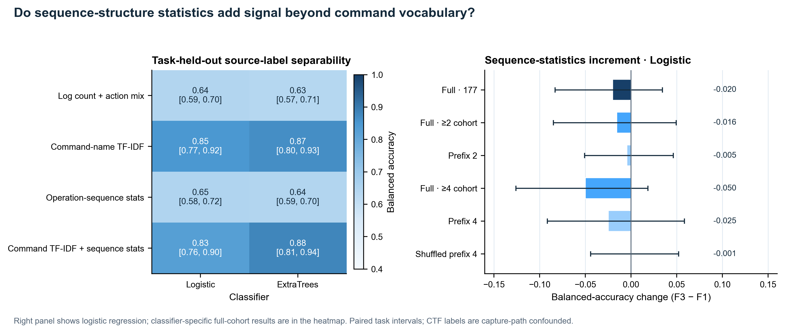
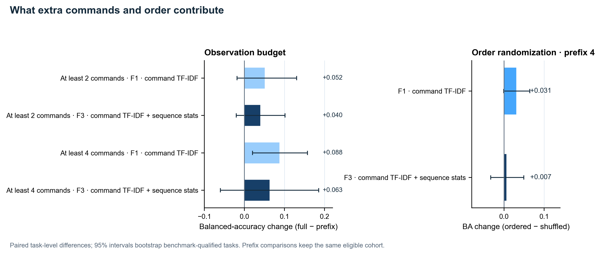
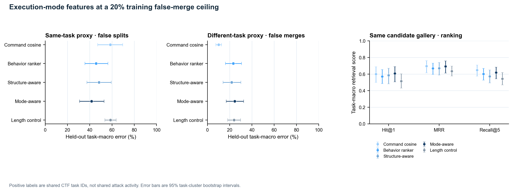
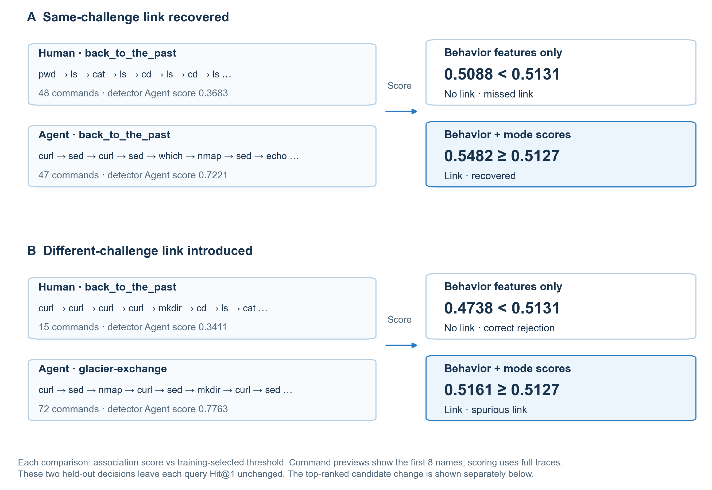
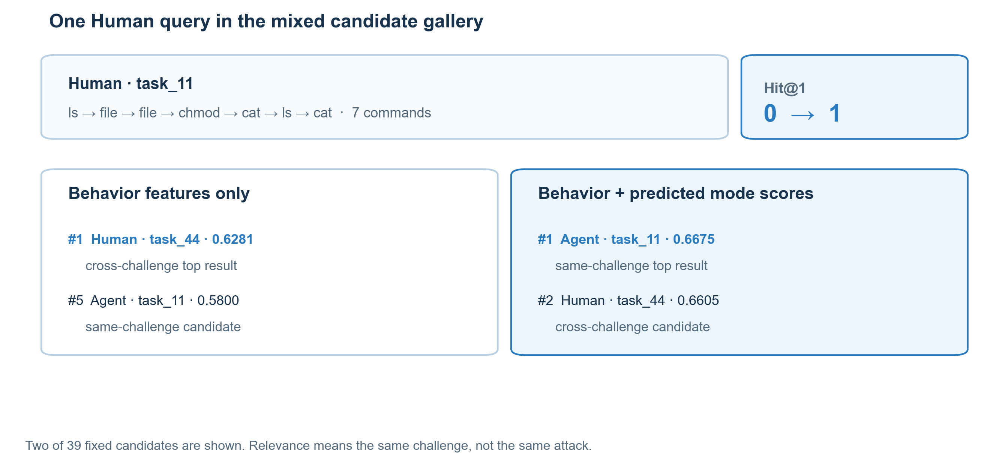

# 执行方式特征与行为关联：实验记录

2026-10-30。本轮 CPU 实验检验两个递进问题：日志中哪些特征区分公开数据标注的 Human 与 Agent 轨迹；在固定误合并目标时，执行方式分数是否改变行为轨迹的候选排序与关联错误。

## 结论

在当前 CTF 语料中，命令词汇是最强的单组输入：任务留出平衡准确率约为 0.85；不含命令数量的固定序列统计单独约为 0.65。把结构统计加到命令词汇后，效果依赖分类器，逻辑回归下降 2.0 个百分点，ExtraTrees 上升 1.4 个百分点。词汇模型在至少四条命令的同一批任务上，使用完整轨迹比只看前四条命令高 8.8 个百分点；顺序打乱造成的差异区间跨零。

关联实验展示了执行方式进入行为关联后的具体变化：在相同候选库和训练误合并目标下，加入模式分数后，同题 Human–Agent 漏关联减少 12.7 个百分点，Hit@1 增加 3.6 个百分点；异题 Human–Agent 错误关联同时增加 11.9 个百分点。执行方式由此成为可测量的关联上下文，能够解释跨模式操作为何改变候选排序及其错误权衡。它为 AI 时代的攻击行为关联和威胁刻画提供了一条可复现的研究路径。

## 研究问题与相关基础

安全分析人员需要根据日志，把可能属于同一次攻击的零散操作串起来。人和 Agent 的执行流程可能不同，日志中的行为差异因而同时包含“做了什么”和“如何执行”的信息。本研究把执行方式纳入行为关联，测量日志预测分数怎样改变候选轨迹之间的联系，为混合人类、脚本与 Agent 参与的攻击调查增加一个可计算的证据维度。

日志关联已有明确研究基础。HOLMES 从多主机审计行为和信息流生成活动/campaign 线索；OSTINATO 比较跨主机攻击活动相似性；POIROT、HERCULE、ATLAS、ActMiner 与 FALCON 等工作通过审计溯源、行为序列、攻击图或因果关系连接攻击活动。这使“行为证据如何关联”成为已有的安全分析任务，而非为人/Agent 分类临时拼出的应用场景。

执行方式的日志识别也已有紧邻工作。AIT/AECID 的公开项目记录了 Human 与 AI Agent 在 Nextcloud、WordPress 故障排查中的 Linux audit、syslog 和应用日志，并提供时间特征、审计字段和分类分析入口。该项目不是攻击活动关联研究，但意味着本文不能把“首次根据日志区分 Human 与 AI”作为贡献。更窄且可检验的贡献应是：**把执行方式作为行为关联的上下文变量，比较它对同源候选误拆分和异源候选误合并的共同影响。** AIT 项目的 README 要求引用论文/学位论文，但没有声明数据再利用许可；截至 2026-10-30，仓库 `LICENSE` 路径为 404，因此没有下载、训练或再分发其日志。[AIT/AECID 项目](https://github.com/ait-aecid/llm-user-shell-sim)

## 数据与标签

主实验使用固定版本 [Cyber Task Horizons](https://github.com/lyptus-research/cyber-task-horizons-data)（revision `178c0da1800f9c07311e1b8d6c61dd8104e7b4ae`，CC BY 4.0）。从 InterCode-CTF、CyBench 与 NYU CTF Bench 中选取同时包含 Human 与 Agent 记录的题目组，共 177 条非空轨迹、40 个基准限定题目组。

| 基准 | Human 终端记录 | Agent bash 记录 | 题目组 |
|---|---:|---:|---:|
| InterCode-CTF | 40 | 81 | 27 |
| CyBench | 8 | 18 | 6 |
| NYU CTF Bench | 9 | 21 | 7 |
| 合计 | 57 | 120 | 40 |

主特征只用可观测命令名和粗粒度动作序列，不用题目名、路径、文件名、模型名、来源标签或提示文本。正例是同一 benchmark/task，负例是同基准不同题目。标签只表示是否解答同一道 CTF 题，不表示同一攻击行动、主机、攻击者或组织。Human 由终端记录生成，Agent 由工具调用记录生成，采集接口与标签重合；这项混杂无法由任务分组切分消除。

数据源审计保存于 [`results/data_source_audit_v1.json`](results/data_source_audit_v1.json)。AIT/AECID 的日志与任务最接近“同一传感器下比较 Human/Agent”，但因许可不清未用；CAM-LDS v2 有合成攻击步骤标签，却没有执行方式标签，故不把两者拼接成一个训练集。

## E1：特征消融

使用六个预设随机种子，每次按 `(benchmark, task)` 分组做三折留出；向量器、特征和分类器都只在训练折拟合。分数先在每个题目内计算，再对题目、基准等权平均。区间对题目组进行 5,000 次分层簇 bootstrap。分类器固定为平衡逻辑回归与 ExtraTrees，没有用测试集调参。

| 输入 | 逻辑回归 BA | ExtraTrees BA |
|---|---:|---:|
| F0 命令数量 + 动作组成 | 0.643 [0.593, 0.696] | 0.635 [0.565, 0.711] |
| F1 命令 TF-IDF unigram/bigram | 0.849 [0.774, 0.917] | 0.866 [0.796, 0.926] |
| F2 固定序列统计 | 0.648 [0.576, 0.725] | 0.642 [0.589, 0.703] |
| F3 命令 TF-IDF + 序列统计 | 0.828 [0.756, 0.897] | 0.880 [0.809, 0.938] |

主要增量比较为 F3−F1。逻辑回归变化 −2.0 个百分点（95% CI [−8.3, +3.3]），ExtraTrees +1.4 个百分点（[+0.3, +2.5]）。因此，现有低成本结构统计没有跨分类器的一致增量；命令词汇是当前数据中主要的可分信号。考虑到日志来源和标签混杂，不能把这个信号解释为人类决策风格或 Agent 行为本质。



图右侧的结构增量展示逻辑回归；左右分类器的完整结果均列在上表。

生成脚本：[`scripts/run_feature_ablation.py`](scripts/run_feature_ablation.py)、[`scripts/plot_feature_ablation.py`](scripts/plot_feature_ablation.py)。逐题指标和预测分别在 `results/feature_ablation_task_metrics_v1.csv`、`results/feature_ablation_predictions_v1.csv`；完整结果为 [`results/feature_ablation_v1.json`](results/feature_ablation_v1.json)。

## E2：观察预算、顺序与迁移

观察预算只在相同任务队列中比较完整轨迹和前缀。至少四条命令的 99 条记录、25 个任务组里，F1 的完整轨迹比前四条命令高 8.8 个百分点（95% CI [+2.0, +15.7]）；F3 高 6.3 个百分点（[−6.0, +18.5]）。至少两条命令的 175 条记录、40 个任务组里，F1 完整轨迹优势为 5.2 个百分点（[−1.9, +13.0]），F3 为 4.0 个百分点（[−2.0, +10.1]）。只有较长队列中的词汇模型增量区间没有跨零。

在前四条命令队列对齐命令与动作后打乱顺序，运行五个固定种子。原序列减去打乱序列的 F1 差异为 +3.1 个百分点（95% CI [−0.1, +6.4]）；F3 为 +0.7 个百分点（[−3.3, +4.9]）。当前没有足够证据表明这些粗结构特征具有稳定的顺序收益。与其说“Agent 有独特操作节奏”，更贴近结果的描述是：更长轨迹提供了更多与本语料来源/工具接口有关的词汇信息。

留一基准的 F1/F3 平衡准确率分别是：CyBench 0.736/0.806（6 组）、InterCode-CTF 0.870/0.880（27 组）、NYU CTF Bench 0.917/0.774（7 组）。结构统计在不同基准上的方向不一致。

按题目分组的留一 Agent 模型测试中，测试只包含被留出模型的 Agent 记录及其同题 Human 记录；该题目整体不进入训练，其他 Agent 模型用于训练。三个模型面板各有 40 个题目组，Human 测试记录会在模型面板间复用，因此这些面板不是独立重复实验。F1/F3 BA：Claude Opus 0.813/0.806，Claude Sonnet 0.882/0.815，GPT-5.5 0.871/0.839；命令词汇仍高于或接近组合特征。旧的“整套模型全部留出且排除所有同题训练记录”切分不可估计，因为三个模型覆盖了所有题目组，排除测试题后没有训练数据。

| 留出 Agent 模型 | F1 命令词汇 BA | F3 命令 + 结构 BA |
|---|---:|---:|
| Claude Opus | 0.813 [0.719, 0.904] | 0.806 [0.713, 0.891] |
| Claude Sonnet | 0.882 [0.802, 0.952] | 0.815 [0.729, 0.900] |
| GPT-5.5 | 0.871 [0.785, 0.951] | 0.839 [0.712, 0.946] |



衍生配对结果与绘图脚本：[`results/feature_ablation_contrasts_v1.json`](results/feature_ablation_contrasts_v1.json)、[`scripts/summarize_feature_contrasts.py`](scripts/summarize_feature_contrasts.py)。模型来源留出：[`results/agent_model_transfer_v1.json`](results/agent_model_transfer_v1.json)、[`scripts/run_agent_model_transfer.py`](scripts/run_agent_model_transfer.py)。

## E3：固定误合并预算下的关联效用

外层仍按题目三折留出；每个外层训练折内再做三折留出，仅用这些内层任务的配对分数为各方法选阈值。主工作点在训练数据上要求宏误合并率不超过 20%，并在可行阈值中使误拆分最低。外层测试的候选库对所有方法相同，包含同一基准留出折中的所有轨迹；不按模式过滤。由于样本变化，测试误合并率可能高于训练目标，因此同时报告两类实际测试错误。

| 方法 | 测试误拆分 | 测试误合并 | Hit@1 |
|---|---:|---:|---:|
| 命令余弦 | 0.585 [0.471, 0.696] | 0.101 [0.075, 0.126] | 0.600 [0.500, 0.688] |
| 行为排序器 | 0.457 [0.357, 0.563] | 0.233 [0.162, 0.307] | 0.571 [0.485, 0.653] |
| 结构增强 | 0.483 [0.375, 0.593] | 0.218 [0.140, 0.301] | 0.584 [0.482, 0.670] |
| 模式增强 | 0.416 [0.308, 0.528] | 0.245 [0.169, 0.326] | 0.607 [0.507, 0.689] |
| 仅长度控制 | 0.586 [0.535, 0.637] | 0.240 [0.182, 0.298] | 0.514 [0.432, 0.603] |

在主 20% 工作点，模式增强相对行为排序器的 Hit@1 增量为 +3.6 个百分点（95% CI [+0.6, +6.8]），MRR 为 +2.4 个百分点（[+0.2, +4.7]）；总体误拆分下降 4.1 个百分点（[−7.4, −0.7]），总体误合并上升 1.2 个百分点（[−1.5, +4.1]）。分层后，**同题 Human–Agent 误拆分下降 12.7 个百分点（[−19.0, −6.5]），异题 Human–Agent 误合并上升 11.9 个百分点（[+7.9, +16.3]）**。这组相反方向的变化，是执行方式分数改变同题匹配判断的实测现象。

但强命令余弦的 Hit@1 为 0.600，95% CI [0.500, 0.688]，总体误合并更低；模式增强没有在所有指标上占优。10%、30% 训练误合并目标下的指标、逐折阈值、所有候选分数与任务级结果见 [`results/association_operating_points_v1.json`](results/association_operating_points_v1.json) 及相邻 CSV。



运行入口：[`scripts/run_association_operating_points.py`](scripts/run_association_operating_points.py)；绘图源：[`scripts/plot_association_operating_points.py`](scripts/plot_association_operating_points.py)。Notebook：[`notebooks/10_association_operating_points_v1.ipynb`](notebooks/10_association_operating_points_v1.ipynb)。

## 案例：执行方式分数怎样改变关联

对冻结的 5,236 条有向配对逐条复算后，选出三类阈值判定案例，以及一条 Hit@1 从 0 变成 1 的排序案例。案例依公开任务标签和轨迹 ID 按字典序选择，不按得分幅度挑选。图中只展示命令名，不包含命令参数、路径和输出。

**排名案例 C4/C5。** InterCode-CTF 的留出 Human 查询 `d209c425ee9ce2bf` 有 39 条固定候选。行为排序把异题 Human 轨迹 `4cdc4644c4f559d9`（task_44，0.6281）排第 1，把同题 Agent 轨迹 `1d9f0d5a2f0a520d`（task_11，0.5800）排第 5。加入折外预测的执行方式分数后，同题 Agent 分数升至 0.6675、排第 1；异题 Human 分数为 0.6605、降至第 2。该查询 Hit@1 从 0 变为 1。全体查询的 +3.6 个百分点仍是总体统计，不由这个单例推导；按预设排名变化条件筛选，符合条件的查询共有 2 条。

**阈值案例 C1–C3。** C1 中，CyBench `back_to_the_past` 的 Human/Agent 轨迹分别有 48 和 47 条命令；关联分数从 0.5088 变为 0.5482，并跨过各自训练折选出的阈值 0.5131/0.5127，恢复了同题配对。但候选排名仍为第 4，查询 Hit@1 前后都是 1，所以它解释阈值错误，不解释 Hit@1 增量。C2 展示代价：Human `back_to_the_past` 与 Agent `glacier-exchange` 的异题配对从拒绝（0.4738）变为误连（0.5161）。C3 是同题 `flag_command` 的持续漏关联（0.4476/0.4287 均低于相应阈值）。这些个例与总体的“减少同题跨模式漏关联，同时增加异题跨模式误关联”一致。





案例选择、候选分数、预测执行方式分数、冻结阈值、候选名次和折外复算记录：[`results/association_cases_v1.json`](results/association_cases_v1.json)。五个案例的独立折内复算与冻结配对分数最大绝对差为 0；选择了两个外层折，训练与留出题目无交叉。完整配对目录：[`results/association_case_catalog_v1.csv`](results/association_case_catalog_v1.csv)。生成代码：[`scripts/extract_association_cases.py`](scripts/extract_association_cases.py) 和 [`scripts/plot_association_cases.py`](scripts/plot_association_cases.py)。

## 对论文主张的影响

公开 CTF 检索结果显示，执行方式分数可以改变关联排名及跨模式错误结构：主划分 Hit@1 上升 3.6 个百分点，同题 Human–Agent 漏关联下降 12.7 个百分点，异题 Human–Agent 错误关联上升 11.9 个百分点。这个结果把执行来源从“检测器预测标签”推进为“活动关联可检验的上下文变量”，并指出了后续系统设计需要同时控制的两类错误。

下一项决定性评估是在统一 auditd/主机遥测下重复执行同一安全任务，让人类、固定脚本和 Agent 分别产生轨迹，并用独立活动 ID 标注关联正负例；按任务、操作者、Agent 模型与主机分组留出，比较排序、阈值错误和校准。当前 CTF 标签表示同题检索相关性，且采集接口与 Human/Agent 标签重合，因此结论的适用范围限于这一公开基准上的行为检索实验。AIT/AECID 可以作为许可核查后的候选数据源；目前未使用其日志。

## 复现

数据下载和校验后，在 CPU 上运行：

```bash
.venv/bin/python scripts/run_feature_ablation.py
.venv/bin/python scripts/summarize_feature_contrasts.py
.venv/bin/python scripts/run_agent_model_transfer.py --bootstraps 5000
.venv/bin/python scripts/run_association_operating_points.py --bootstraps 5000 --threshold-grid 101
.venv/bin/python scripts/extract_association_cases.py --refit
.venv/bin/python scripts/plot_association_cases.py
.venv/bin/python scripts/plot_feature_ablation.py
.venv/bin/python scripts/plot_association_operating_points.py
```

Notebook 分别为 `09_feature_ablation_v1.ipynb` 与 `10_association_operating_points_v1.ipynb`。代码、结果 JSON/CSV 和矢量/位图都保留在仓库；原始公开轨迹文件受上游许可管理且不提交到 Git。本轮不需 GPU，不调用付费 API。
