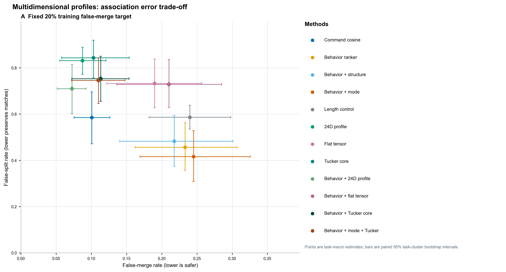
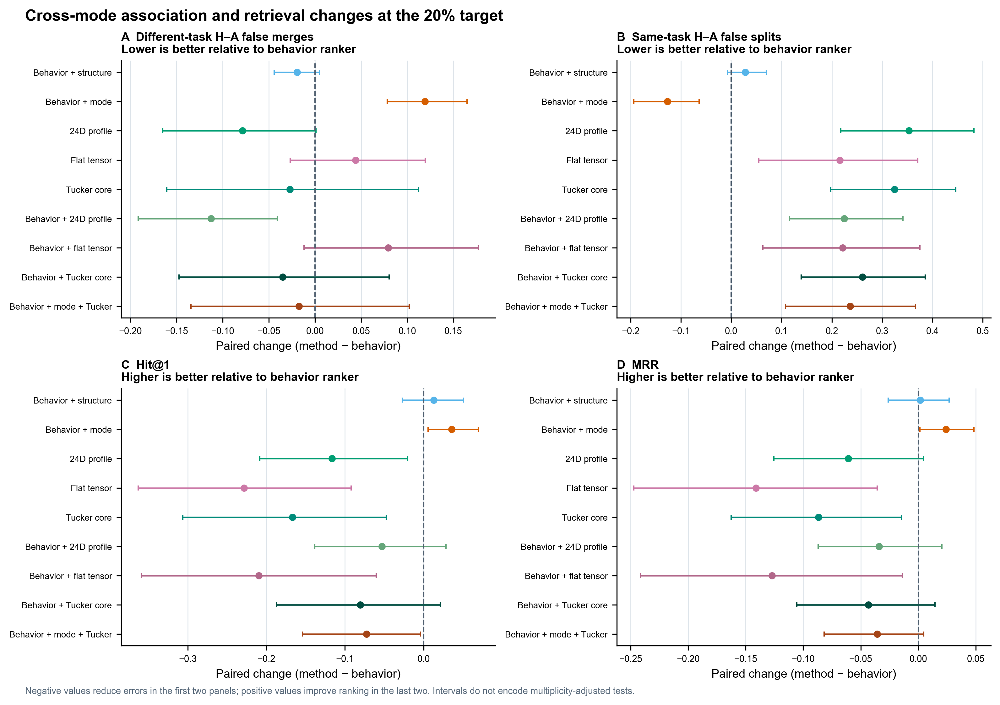
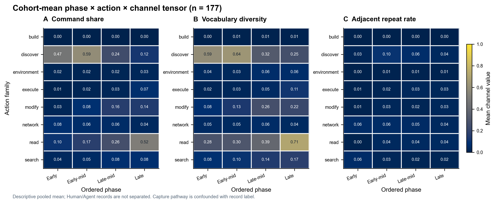

# 多维行为画像关联实验结果

本页记录冻结计划 `12-多维行为画像关联实验计划.md` 的执行结果。实验使用已被探索过的 CTH 固定队列；这些结果属于探索性复用，不是独立确认。

- 数据：177 条轨迹、40 个 `(基准, 题目)` 组；正例为同题 CTF 轨迹。
- Human 终端记录与 Agent 工具调用的采集渠道不同，且与记录标签混杂；不据此推断稳定人格、真实活动归属或组织归因。
- 多维表示：24 个标量特征 + `4 × 8 × 3` 张量；通道为命令占比、操作类内词汇多样度、相邻同命令重复率。
- Tucker/HOSVD 对照在各训练折内拟合固定 `(2, 4, 2)` 秩；这是结构保留的低秩对照，不是原始 TSA 算法的复现。
- 切分：3 折按题目留出；阈值只在外层训练集内的 3 折 OOF 分数上选择；20% 宏误合并率是主目标，10%/30% 是预设敏感性工作点。
- 区间：95% 配对基准分层题目簇 bootstrap 区间，5,000 次抽样；重复切分没有被当成独立样本。

## 20% 训练误合并目标

下表同时列出完整操作阈值指标和不依赖阈值的检索指标。数值为估计值 [95% 区间]，均以百分比表示。实际测试 FMR 不受训练目标保证；命中率下降或漏关联上升也完整保留。

| 方法 | FMR | FSR | H–A FMR | H–A FSR | Balanced accuracy | Query coverage | Hit@1 | MRR | Recall@5 | NDCG@5 |
|---|---|---|---|---|---|---|---|---|---|---|
| 命令余弦 | 10.1 [7.5, 12.6] | 58.5 [47.1, 69.6] | 3.2 [2.0, 4.5] | 67.0 [54.0, 79.7] | 65.7 [60.0, 71.4] | 67.5 [55.9, 78.3] | 60.0 [50.0, 68.8] | 69.5 [61.5, 76.2] | 64.8 [57.6, 70.9] | 61.8 [54.2, 68.3] |
| 行为排序器 | 23.3 [16.2, 30.7] | 45.7 [35.7, 56.3] | 15.5 [8.9, 23.2] | 51.3 [40.2, 62.3] | 65.5 [59.1, 72.2] | 77.6 [67.6, 85.9] | 57.1 [48.5, 65.3] | 66.9 [59.6, 73.1] | 60.0 [52.7, 66.9] | 57.6 [50.1, 64.6] |
| 行为 + 旧结构 | 21.8 [14.0, 30.1] | 48.3 [37.5, 59.3] | 13.6 [7.8, 20.2] | 54.1 [42.1, 66.2] | 65.0 [58.3, 71.7] | 75.3 [65.5, 83.6] | 58.4 [48.2, 67.0] | 67.0 [58.9, 73.9] | 57.3 [49.3, 65.0] | 55.7 [47.7, 63.3] |
| 行为 + 旧模式 | 24.5 [16.9, 32.6] | 41.6 [30.8, 52.8] | 27.5 [18.2, 37.9] | 38.6 [25.5, 52.5] | 67.0 [60.4, 73.4] | 82.0 [72.4, 89.6] | 60.7 [50.7, 68.9] | 69.3 [61.3, 75.8] | 61.9 [54.4, 68.3] | 60.4 [52.3, 67.3] |
| 长度控制 | 24.0 [18.2, 29.8] | 58.6 [53.5, 63.7] | 24.1 [16.4, 31.7] | 65.1 [56.0, 74.3] | 58.7 [54.5, 62.9] | 78.5 [72.0, 84.8] | 51.4 [43.2, 60.3] | 63.6 [57.8, 69.5] | 54.3 [46.9, 61.9] | 51.4 [43.8, 59.6] |
| 24 维画像 | 8.7 [5.5, 12.1] | 83.2 [77.2, 88.9] | 7.7 [4.8, 10.5] | 86.6 [80.0, 92.4] | 54.1 [51.7, 56.6] | 42.5 [29.0, 54.7] | 45.5 [34.7, 56.0] | 60.8 [54.0, 67.6] | 58.2 [51.6, 64.4] | 52.6 [45.6, 59.5] |
| 展平张量 | 19.0 [12.2, 25.7] | 73.2 [62.7, 83.8] | 19.9 [12.7, 27.2] | 72.9 [61.9, 83.7] | 53.9 [49.5, 58.7] | 47.1 [30.5, 62.3] | 34.3 [21.4, 47.2] | 52.8 [44.0, 61.8] | 45.2 [37.0, 53.2] | 41.0 [32.8, 48.9] |
| Tucker 张量子空间 | 10.3 [5.8, 15.4] | 84.4 [75.6, 91.9] | 12.8 [4.9, 22.2] | 83.7 [70.2, 95.0] | 52.7 [49.8, 55.9] | 34.0 [21.0, 48.5] | 40.5 [29.0, 51.2] | 58.2 [51.2, 64.7] | 54.2 [49.0, 59.5] | 48.8 [44.6, 53.1] |
| 行为 + 24 维画像 | 7.3 [5.1, 9.3] | 71.0 [60.2, 81.4] | 4.3 [2.3, 6.5] | 73.8 [61.6, 85.2] | 60.9 [56.1, 65.8] | 51.3 [35.0, 66.1] | 51.8 [41.2, 61.8] | 63.5 [55.7, 70.4] | 56.6 [47.8, 64.3] | 54.3 [45.4, 62.5] |
| 行为 + 展平张量 | 21.0 [13.6, 28.5] | 72.9 [62.9, 83.6] | 23.5 [14.6, 32.7] | 73.4 [62.5, 84.0] | 53.1 [48.5, 58.1] | 47.9 [31.5, 63.1] | 36.2 [22.3, 49.9] | 54.2 [45.0, 63.0] | 46.8 [38.6, 54.3] | 42.5 [34.6, 50.4] |
| 行为 + Tucker 子空间 | 11.3 [7.2, 15.4] | 75.3 [65.5, 85.0] | 12.0 [6.2, 18.7] | 77.4 [61.4, 90.5] | 56.7 [53.2, 60.2] | 48.0 [31.6, 63.6] | 49.1 [39.2, 59.2] | 62.5 [55.6, 69.2] | 55.6 [49.7, 61.1] | 52.1 [46.3, 57.3] |
| 行为 + 模式 + Tucker | 11.0 [7.2, 14.8] | 74.6 [64.6, 84.3] | 13.8 [7.6, 20.9] | 74.9 [59.5, 88.4] | 57.2 [53.8, 60.7] | 48.7 [32.6, 65.0] | 49.9 [41.1, 57.9] | 63.3 [56.9, 69.2] | 59.2 [53.6, 64.1] | 54.7 [48.7, 59.7] |

## 相对行为排序器的配对变化（20% 目标）

负的误合并/误拆分变化分别表示该类错误减少；正的 Hit@1、MRR 和 Recall@5 变化表示排序改善。区间未作多重比较校正，不根据其中最小的区间或 p 值挑选赢家。

| 方法 | Δ Overall FMR | Δ Overall FSR | Δ H–A FMR | Δ H–A FSR | Δ Hit@1 | Δ MRR | Δ Recall@5 | Δ NDCG@5 |
|---|---|---|---|---|---|---|---|---|
| 行为 + 旧结构 | -1.5 [-3.5, 0.6] | 2.6 [0.3, 5.1] | -1.9 [-4.4, 0.5] | 2.8 [-0.8, 7.0] | 1.3 [-2.7, 5.1] | 0.2 [-2.6, 2.7] | -2.7 [-6.0, 0.3] | -1.8 [-4.6, 0.4] |
| 行为 + 旧模式 | 1.2 [-1.4, 4.1] | -4.1 [-7.3, -0.7] | 11.9 [7.8, 16.5] | -12.7 [-19.4, -6.4] | 3.6 [0.6, 6.9] | 2.4 [0.1, 4.8] | 1.8 [-0.9, 4.5] | 2.8 [1.0, 4.7] |
| 24 维画像 | -14.6 [-23.3, -6.2] | 37.5 [24.5, 49.3] | -7.9 [-16.5, 0.1] | 35.3 [21.8, 48.3] | -11.7 [-20.8, -2.0] | -6.1 [-12.6, 0.4] | -1.8 [-10.1, 6.6] | -5.0 [-12.2, 2.5] |
| 展平张量 | -4.3 [-7.9, -0.4] | 27.6 [11.2, 42.6] | 4.4 [-2.7, 12.0] | 21.6 [5.5, 37.1] | -22.9 [-36.3, -9.2] | -14.1 [-24.7, -3.6] | -14.8 [-25.2, -4.7] | -16.5 [-26.7, -6.3] |
| Tucker 张量子空间 | -13.0 [-24.2, -1.8] | 38.7 [25.5, 51.3] | -2.7 [-16.1, 11.2] | 32.4 [19.8, 44.7] | -16.7 [-30.6, -4.7] | -8.7 [-16.3, -1.5] | -5.8 [-13.0, 0.9] | -8.7 [-14.9, -3.1] |
| 行为 + 24 维画像 | -16.0 [-24.3, -7.8] | 25.3 [13.3, 38.3] | -11.3 [-19.2, -4.1] | 22.5 [11.6, 34.1] | -5.3 [-13.8, 2.8] | -3.4 [-8.7, 2.0] | -3.4 [-10.4, 3.4] | -3.3 [-9.3, 2.7] |
| 行为 + 展平张量 | -2.3 [-6.4, 2.4] | 27.2 [11.3, 42.4] | 7.9 [-1.2, 17.7] | 22.2 [6.3, 37.5] | -21.0 [-35.9, -6.0] | -12.7 [-24.1, -1.4] | -13.3 [-22.1, -3.9] | -15.1 [-25.0, -4.6] |
| 行为 + Tucker 子空间 | -12.0 [-21.8, -2.4] | 29.6 [17.1, 42.6] | -3.5 [-14.7, 8.0] | 26.1 [13.9, 38.6] | -8.1 [-18.7, 2.1] | -4.3 [-10.6, 1.4] | -4.5 [-8.2, -0.8] | -5.5 [-9.0, -2.2] |
| 行为 + 模式 + Tucker | -12.3 [-22.2, -2.7] | 28.9 [16.0, 41.8] | -1.7 [-13.4, 10.2] | 23.6 [10.8, 36.7] | -7.3 [-15.4, -0.4] | -3.6 [-8.2, 0.5] | -0.9 [-5.0, 3.0] | -2.9 [-6.2, 0.2] |

## 张量画像与特征保存

张量热图为全队列均值（Human 57 条、Agent 120 条合并后计算），没有按记录标签分层，避免把采集渠道差异包装成画像差异。

可复用文件：

- `results/multidimensional_profile_association_v1/results.json`：完整方法、指标、区间、阈值和折信息。
- `results/multidimensional_profile_association_v1/pair_scores.csv`、`task_metrics.csv`、`thresholds.csv`：配对分数、任务级结果和阈值审计。
- `results/multidimensional_profile_association_v1/behavior_profiles_v3.jsonl`：逐轨迹 label-free 24 项画像、4 × 8 × 3 张量和外层留出模式预测；不含评估真值。
- `results/multidimensional_profile_association_v1/evaluation_labels.csv`：单独保存的 Human/Agent 评估标签与题目分组。
- 绘图和生成入口：`scripts/plot_multidimensional_profile_association.py`、`scripts/render_multidimensional_profile_report.py`、`scripts/build_tensor_demo_assets.py`。

## 研究页动画

研究页用三张通道切片呈现总体张量均值，动画按阶段逐步推进。动画是特征构造示意，不是分类表现或关联结果；静态 SVG 是回退显示，JavaScript 遵循系统减少动态效果设置。
