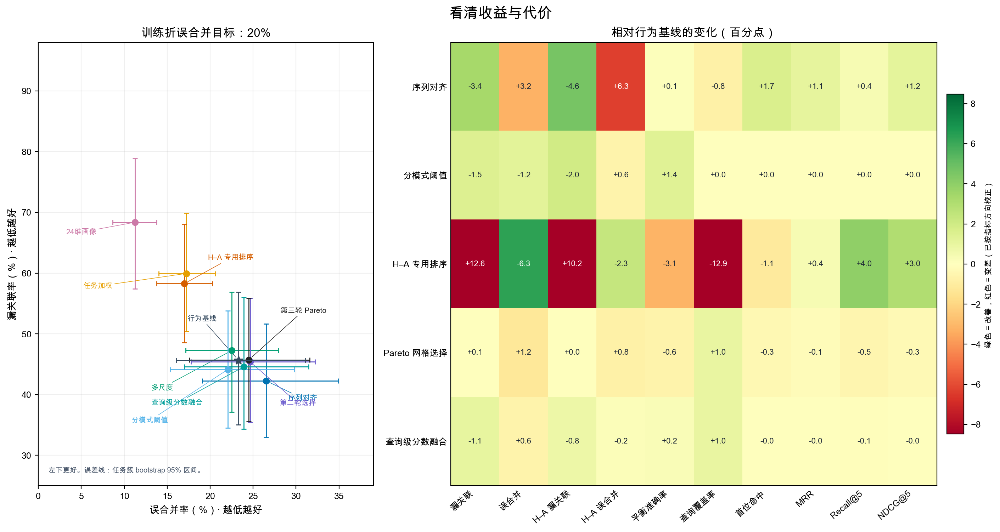

# 漏关联优化实验结果

**结论：** 在当前 177 条轨迹、40 个任务组上，四轮嵌套实验都没有找到能让十项指标同时变好的方案。第四轮查询级分数融合降低了总体及 H–A 漏关联、略降 H–A 误合并，却让总体误合并上升；检索排序没有稳定改善。全指标选择只在三折中的一折启用新方法。

## 数据与判定

数据来自 InterCode-CTF、CyBench、NYUCTF，共 57 条 Human 终端轨迹、120 条 Agent 工具轨迹。以“同一道 CTF 题”为检索标签，按任务组做三折嵌套留出；主工作点为训练折误合并目标 20%。置信区间按基准内任务组配对重采样 5,000 次。40 个任务此前已查看，因此所有轮次均是探索性复用，不是独立确认。

FSR 表示同题配对漏关联率；FMR 表示异题配对误关联率。Human–Agent 指两种执行方式之间的配对。平衡准确率、覆盖率和排序指标越高越好，错误率越低越好。

## 四轮结果

| 相对行为基线的变化 | 分模式阈值¹ | 第三轮 Pareto 选择² | 第四轮查询级融合³ |
|---|---:|---:|---:|
| 总体漏关联 FSR | −1.50 pp [−4.34, +0.86] | +0.06 pp [−2.77, +4.15] | **−1.05 pp [−2.22, −0.12]** |
| 总体误关联 FMR | −1.23 pp [−3.11, +0.53] | **+1.20 pp [+0.51, +1.97]** | **+0.64 pp [+0.14, +1.26]** |
| H–A 漏关联 | −1.95 pp [−4.22, 0.00] | 0.00 pp [−3.09, +4.12] | −0.79 pp [−1.88, 0.00] |
| H–A 误关联 | **+0.65 pp [+0.33, +1.04]** | **+0.78 pp [+0.25, +1.38]** | **−0.20 pp [−0.43, −0.01]** |
| 平衡准确率 | +1.37 pp [+0.02, +2.88] | −0.63 pp [−2.64, +0.66] | +0.21 pp [−0.14, +0.70] |
| 查询覆盖率 | 0.00 pp [0.00, 0.00] | +0.95 pp [0.00, +2.86] | +0.95 pp [0.00, +2.86] |
| Hit@1 | 0.00 pp | −0.34 pp [−1.76, +0.93] | −0.03 pp [−1.36, +1.08] |
| MRR | 0.00 pp | −0.13 pp [−1.36, +0.97] | −0.03 pp [−1.10, +0.79] |
| Recall@5 | 0.00 pp | −0.50 pp [−2.12, +0.74] | −0.10 pp [−0.50, +0.28] |
| NDCG@5 | 0.00 pp | −0.30 pp [−1.44, +0.70] | −0.01 pp [−0.53, +0.45] |

pp 为百分点；错误率的负变化是改善，其他指标的正变化是改善。排序指标的分模式阈值变化为零，因为只移动阈值不会改变排序。

¹ **分模式阈值**按已知配对类型（H–A 或同模式）分别校准。它在点估计上改善三项错误率和总体平衡准确率，但 H–A 误关联增加 0.65 个百分点，95% 区间不跨零；总体 FSR 和 FMR 区间跨零。因此不能称为全面改进。若实际场景拿不到执行方式标签，这种分层阈值也不能直接使用。

² **第三轮 Pareto 选择**在训练折内对全局阈值与 H–A／同模式阈值做固定网格搜索，并要求十项指标在训练折不退步。三折中只有一折选中序列对齐，其余两折回退到基线；汇总后总体和 H–A 误关联均上升，排序指标点估计也略降。训练折的非支配候选没有迁移到留出折。

³ **第四轮查询级融合**把同一查询下的行为分数与命令余弦分数分别转换为候选百分位，再按固定权重网格融合；该变换只读取候选分数，不读取 Human/Agent 标签。仅当内层任务留出中十项指标均不退步时才启用融合，否则回退基线。三折中一折选出 50:50 融合，另外两折回退。留出任务上总体 FSR 下降 1.05 个百分点、H–A FSR 下降 0.79、H–A FMR 下降 0.20；但总体 FMR 上升 0.64 个百分点。平衡准确率略增但区间跨零，四项排序变化都接近零且区间跨零，所以仍不是全指标改善。完整权重、阈值和逐任务结果见 `experiments/recall_hybrid_v1/output/`。

第一轮的序列对齐把总体 FSR 从 45.66% 降到 42.28%，并把 H–A FSR 从 51.28% 降到 46.68%；但总体 FMR 从 23.30% 升到 26.51%，H–A FMR 从 15.54% 升到 21.86%。四项排序指标点估计上升。多尺度阶段特征近乎持平；困难负例和 24 维画像融合都付出了较大的召回代价。第二轮的任务均衡训练与 H–A 专用排序也未消除错误之间的取舍。

图左显示错误率点估计及任务簇 95% 区间；右侧显示相对行为基线的百分点变化，颜色按指标方向校正。原始方法结果、阈值、任务级数据和运行脚本保存在 `results/recall_optimization_v1/`、`results/recall_optimization_v2/`、`results/recall_joint_pareto_v3/` 和 `experiments/recall_hybrid_v1/`。

## 为什么现在难以同时变好

- 当前表征能找回部分短轨迹正配对，但错误分析显示两种方法都漏掉的同题配对，其轨迹长度比中位数为 0.40；两种方法都找回的配对为 0.75。普通序列相似度仍会惩罚“短轨迹是长轨迹局部片段”的情况。
- 12 组跨题轨迹包含完全相同的规范化命令序列，最大一组 `ls, cat` 覆盖 13 道题。仅靠命令名或顺序难以区分这类通用操作。
- 采集方式与标签混杂：300 次 Python 工具调用出现在 70 条 Agent 轨迹中，Human 侧没有对应字段。把这类 Agent 专属字段加入画像会让模型学到采集接口，而非可比较的行为信号，所以已排除。
- 当前标签只表示“同一道题”，不表示同一操作者、攻击者或组织。三个公开 CTF 基准也没有提供同一任务下统一采集的人类、Agent 与脚本轨迹。

## 下一步

四轮之后暂停在这 40 个已查看任务上继续调参。下一步先补采集：同一任务由 Human、Agent、Script 在相同传感器和字段下执行，保存阶段、动作类型、操作对象、参数模式、顺序与轨迹完整度；保留可验证的配对标签。然后冻结训练流程，在新任务、新会话和未见过的 Agent 配置上一次性验证。模型侧优先试部分轨迹覆盖、分通道张量相似度与缺失/完整度校正，并保留独立行为通道，不把执行方式当身份特征。只有新数据上的十项指标及不确定区间支持共同改善，才报告为有效改进。

TeX 章节：`paper/recall-optimization-results.tex`。完整实验计划：`14-漏关联优化实验计划.md`。
