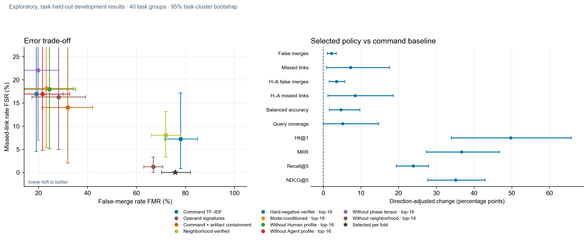

# 轨迹关联：最新结果与误差经验

## 结论

第 11 轮在 40 个任务组的嵌套外层留出中，让总体漏关联与误合并的点估计同时下降，覆盖率与四项排序指标也都上升。**但误合并仍为 75.87%，多数异题候选依然被连上，不能称为可用的归因方法。** 这是复用开发集上的探索结果，不是独立确认。

这次的画像改动是把短轨迹与长轨迹共有的稀有产物按“共享权重 / 较短轨迹权重”计分，减少长轨迹中无关命令对共有文件名的稀释。分数与逐折门槛只用内层任务留出数据确定。第 10 轮虽总体漏关联下降，却有一折从 2.56% 升到 10.26%，按预设规则失败；第 11 轮改用满足全部内层门槛的最低分数阈值后，三折外层都没有高于同折基线的漏关联。

## 第 11 轮：绝对结果与配对变化

最新实验使用 97 条轨迹、40 个任务组（InterCode-CTF、CyBench、NYUCTF），按任务分组三折外层留出。较早的优化轮次使用 177 条记录，但对应同一批 40 个任务组；此轮固定为每题一条 Claude Sonnet Agent 轨迹及其匹配 Human 轨迹，并修复 Human 终端命令解析。两种轨迹来自不同采集接口。

| 指标 | 命令基线 | 第 11 轮逐折入选 | 配对变化，百分点（95% 任务簇区间） |
|---|---:|---:|---:|
| 总体漏关联 FSR | 7.23% | 0.00% | −7.23 [−17.58, −0.82] |
| 总体误合并 FMR | 78.07% | 75.87% | −2.20 [−3.47, −1.09] |
| Human→Agent 漏关联 | 8.47% | 0.00% | −8.47 [−18.61, −1.23] |
| Human→Human 漏关联 | 0.00% | 0.00% | 0.00 [0.00, 0.00] |
| Agent→Agent 漏关联 | 无法估计 | 无法估计 | 每题只有一条 Agent 轨迹 |
| 平衡准确率 | 57.35% | 62.06% | +4.71 [+1.57, +9.68] |
| 查询覆盖率 | 94.83% | 100.00% | +5.17 [0.00, +14.70] |
| Hit@1 | 29.60% | 79.31% | +49.71 [+34.63, +65.93] |
| MRR | 49.80% | 86.50% | +36.71 [+27.32, +46.35] |
| Recall@5 | 73.26% | 97.12% | +23.86 [+19.37, +28.11] |
| NDCG@5 | 53.34% | 88.45% | +35.11 [+27.53, +43.23] |

错误率负变化代表改善；其余指标正变化代表改善。区间按基准分层，对 40 个任务组做 5,000 次配对重采样。

### 如何理解观测到的 0% 漏关联

逐折入选方案接纳了外层预测中的 148/148 条有向同题候选配对，40 个正例任务组中观测到 0 个含漏关联任务组。由于样本里没有漏关联事件，普通 Bootstrap 的 FSR 区间退化为 [0, 0]，不能说明新任务也不会漏。如果把 40 个任务组视为独立簇，0/40 对“出现任一漏关联的任务组比例”给出 7.2% 的单侧 95% 精确上限；这是敏感性界限，不是任务宏 FSR 的置信区间。

**绝对误合并率仍是 75.87%。** 所以 0% 是这批留出配对中的观测值，不能单独当成实用性证据。锁定外部集的原始 95.3% 任务宏误合并率仍单独保留作参照，见 [外部结果与逐对数据](paper/multidimensional-rerun-results.tex)。

## Human/Agent 画像贡献：有信号，但还不能归因

第 11 轮的困难负例验证器诊断显示：通用验证器在其内层效用阈值下 FMR 为 19.1%，但 FSR 为 16.9%，没有通过漏关联门槛。加入 Human/Agent 条件后为 FMR 23.2%、FSR 18.2%。从条件模型移除 Human 画像后 FMR 升至 24.5%；移除 Agent 画像后 FMR 降至 21.6%。这些消融方向不一致，而且所有验证器点的 FSR 都高于 7.23% 基线，不能据此宣称 Human/Agent 专属画像已经改善关联。

另一项独立的执行方式分类复核使用 177 条记录：命令 TF–IDF 平衡准确率为 84.9%，24 维数值画像为 65.6%，内层筛选融合为 83.9%。融合与基线差值为 −1.0 个百分点（95% 任务簇区间 −3.1 至 +1.0），区间跨零。该结果也没有证明数值画像有稳定增益。

## 失败轮次留下的经验

| 轮次 | 变化 | 结果与处理 |
|---|---|---|
| v10 | 稀有产物包含度，效用最大化阈值 | 总体指标看似改善，但第三折 FSR 10.26% 高于基线 2.56%；失败，不作为当前工作点。[逐例审计](results/balanced_innovation_v10/error_audit.md)。 |
| v11 | 在全部内层硬门槛内选最低阈值，优先召回 | 三折 FSR 均未高于基线；保留为目前较好的开发集折中点，但 FMR 仍很高。 |
| v12–v13 | top-16 候选并用困难负例验证器；从分位数扫描扩展到全部观测分数断点 | FMR 较低的阈值无法守住 FSR 门槛；精确扫描仍无可行内层阈值，按协议回退命令基线。 |

v10 的两组新增漏关联与 v12–v13 验证器取舍分别保存在 [逐例审计](results/balanced_innovation_v10/error_audit.md) 和 [阈值/消融审计](results/balanced_innovation_v13/error_audit.md) 中。

错误案例还暴露出 Human 终端输入解析问题：击键日志可能包含删除与重打，原解析器把实际 `cat chall_1.S` 读成 `cat chall`。利用终端输出中回显的命令并重建编辑后，41 条 Human 轨迹的命令头或参数发生变化。另一个主要难点是轨迹长度不对称：短 Human 轨迹和长 Agent 轨迹共享同一产物时，普通 Jaccard 会被长轨迹里的无关命令稀释。

## 评估边界与后续

“同题”只表示共享 CTF 任务，是检索代理标签，不代表同一人员、Agent、攻击者、活动或组织。Human 输入与 Agent 工具调用来自不同采集接口，执行方式也与采集方式混杂；当前队列无法估计 Agent→Agent 漏关联。下一轮应新增多个 Agent 模型与重复运行、保持稳定主体 ID、以未参与调参的新任务作一次性确认，并优先补齐同接口 Human/Agent 轨迹和真实配对标签。

逐对结果可在研究页任务浏览器查看，也可直接读 [开发集 JSON](site/data/task-association-v2.json)。主要协议与完整结果：

- [第 11 轮方案](experiments/balanced_innovation_v11/program.md) 与 [机器可读结果](results/balanced_innovation_v11/results.json)
- [第 13 轮精确阈值方案](experiments/balanced_innovation_v13/program.md) 与 [机器可读结果](results/balanced_innovation_v13/results.json)
- [24 维画像复核](experiments/feature_profiles_v2/program.md)
- [锁定外部评估与 95.3% 误合并率](paper/multidimensional-rerun-results.tex)
