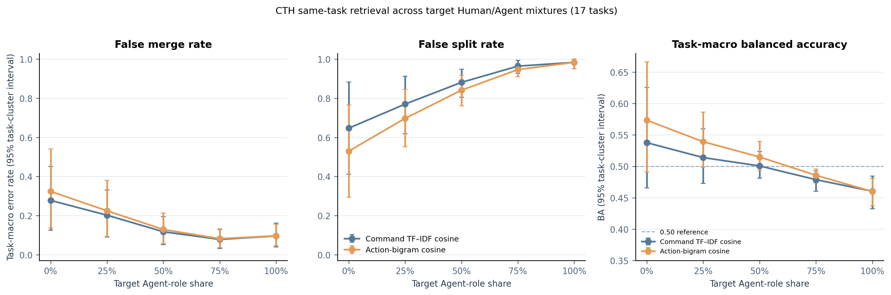

# Human / Agent 行为指纹实验 v1：执行结果

日期：2026-11-02。状态：按冻结协议完成可用轨道；CTF 混合矩阵增量未达到预设数据门槛，因此未运行。

## 研究问题

本轮检验三件不同的事：

1. 从通用命令与粗粒度动作统计构成的窗口矩阵，能否预测数据集提供的 Human / Agent 标签？
2. 在 CTF 同题检索代理任务中，逐步改变 Human / Agent 配对构成时，原有命令相似度的误合并和误拆分如何变化？
3. 在 Agent-only 任务检索中，把行为矩阵加到命令相似度上是否带来收益？

“同题”只表示同一来源中的基准挑战相同，不代表同一个人、Agent、攻击者、攻击活动或 campaign。实验没有给真实活动归属打标签。

## 方法

将每条轨迹按执行次序切成最多128条命令的前缀，每8条命令计算一行8维特征；最短轨迹16条，末尾不足4条的窗口丢弃。行数随轨迹长度变化，不把轨迹切成预设的攻击阶段。

| 维度 | 测量内容 |
|---|---|
| K1 | 不同命令名占比 |
| K2 | 命令名熵 |
| K3 | 最常见命令名占比 |
| K4 | 相邻粗粒度动作类别切换率 |
| K5 | 下一动作类别的条件熵 |
| K6 | 最长连续相同动作长度占比 |
| K7 | 重复粗粒度动作对占比 |
| K8 | 相邻命令名相同率 |

命令归为 discover、read、search、execute、build、network、modify、environment 八类。缺失动作映射留为缺失值。分类读出为每列窗口均值、总体标准差和随窗口位置的线性斜率，共24项；训练集内拟合缺失值和标准化，再用类别平衡 Logistic Regression（C=1、阈值0.5）。另将原始窗口矩阵用 train-only 缩放和 masked DTW 进行直接匹配。没有使用SVD/TSA或ID、题目、模型、提示词、路径、时间戳、标签、来源和采集格式作为输入。

## 数据与资格

更大的标准化目录有1,142条记录，其中664条属于CTF轨迹，478条为补充任务/安全轨迹。本轮按问题拆成三条评估线：

- **Human / Agent 识别：** AIT/AECID Linux audit 日志来自 Nextcloud/WordPress 排障任务；原归档109次运行，既有解析实验可用95次，达到本轮矩阵证据门槛的89次（45 Human、44 Agent），覆盖12个任务组。这里的“攻击行为”不是实验任务，识别目标是发布标签。
- **配比与配对错误：** Cyber Task Horizons (CTH) CTF 中选17个同时有至少2条 Human 和2条 Agent 的题目组，共85条轨迹。每个查询对应一个同题正例和四个异题负例。按目标0%、25%、50%、75%、100% Agent角色配比各重复抽样100次。34个查询/候选角色槽无法精确实现四分之一和四分之三，实际分配为8/34（23.5%）与26/34（76.5%）；图表统一标目标配比。
- **Agent-only 检索：** CTH 121条/48题，每查询5个候选；Antieval Cybench 31条/12题，每查询3个候选。两来源分别训练、分别评估，未把不同候选数的准确率合并。

Human CTH 由终端 `script` 采集，Agent CTH 来自结构化工具调用；因此执行标签与采集接口交织。AIT 使用 Linux auditd 的可观测命令视图，但仍受任务、人员/模型组和应用环境影响。Agent-only 数据没有 Human 样本。

## 实验结果

### 标签识别

| AIT 评估面板 | 命令 TF-IDF BA | 窗口矩阵 BA |
|---|---:|---:|
| 按任务留出（主面板） | 96.8% (95% CI 94.2–99.2) | 56.3% (40.8–71.7) |
| 按人员/模型来源组留出 | 82.6% | 39.9% |
| 按应用留出 | 95.1% | 45.8% |
| 任务与来源同时留出 | 80.0% | 37.6% |

主面板中，整段K1–K8静态摘要为55.2% BA (46.1–65.9)，窗口矩阵摘要为56.3%，配对差为 **+1.1个百分点**（95%任务簇bootstrap区间 -14.3至+15.4，12个任务）。Matrix-DTW 3-NN为53.3%。主面板强词汇分数说明该数据中的标签可由命令词项预测；它不是独立的执行者识别验证。窗口摘要在来源留出下低于机会水平附近，表明不能把本轮K1–K8解释成稳定的人/Agent普适指纹。

### CTF 配比与错误分布

用综合指标看，命令余弦任务宏平均 BA 从目标0%下的53.8%降到目标100%下的46.0%；按17个任务配对的变化为 **−7.73个百分点**（95%任务簇bootstrap区间 **−16.02至−0.42**）。动作二元组BA从57.3%降至46.0%，配对变化 **−11.34个百分点**（95%任务簇区间 **−20.84至−3.26**）。这表明在本轮CTF同题检索代理任务和固定阈值下，整体阈值分类表现随目标Agent配比提高而下降。区间较宽，任务数只有17，不能外推为真实攻击活动关联结论。

错误构成同时发生变化：命令余弦FMR由27.8%降至9.6%，FSR由64.7%升至98.4%；动作二元组基线的FMR由32.4%降至9.6%，FSR由52.9%升至98.4%。因此综合BA下降主要反映同题候选更常被漏掉，不能简化成“所有错误都变多”，也不支持“Agent越多、误合并越多”的预期方向。训练阈值只用训练任务选择，并以训练负例FMR不超过10%为约束。

在50% Agent角色条件的命令余弦结果中：

| 配对类别 | FSR | FMR | 解释边界 |
|---|---:|---:|---|
| HH | 64.7% | 28.2% | Human–Human同题/异题任务代理配对 |
| HA | 93.6% | 5.9% | Human–Agent任务代理配对 |
| AA | 98.6% | 9.7% | Agent–Agent任务代理配对 |

这些数值描述已构成的测试候选和该训练阈值，不能解释为真实攻击活动的拆分率/合并率。阈值检索与Hit@1排名也不同：排名指标回答哪个候选排第一，FMR/FSR回答阈值是否连边。



**未运行的关键实验：** 要评估矩阵是否能校准混合Human/Agent关联，预设至少需要15个题目同时有2条以上Human、2条以上Agent且每条达到16条命令。实际只有1题符合。没有用短轨迹或Agent-only轨道顶替，故本轮不声称指纹修复了关联错误。

### Agent-only 检索与消融

| 来源 | 命令余弦 Hit@1 | 加矩阵 Hit@1 | 配对变化（95%任务簇区间） |
|---|---:|---:|---:|
| CTH（5候选） | 54.9% | 55.2% | +0.35 pp [-3.82,+4.17]，48题 |
| Antieval Cybench（3候选） | 60.4% | 62.5% | +2.08 pp [-6.25,+12.50]，12题 |

两项都未显示可靠增益。CTH删掉K4–K7动作组织维度后Hit@1为56.3%，略高于全矩阵，但配对差区间同样覆盖零。把窗口次序打乱后的性能相近，当前不支持有稳健的顺序信号。

### 探索性跨来源方向实验

训练CTH后在Antieval内做同来源任务检索，命令基线和融合均为51.4%（12题）；反向训练Antieval、在CTH内检索，命令为52.8%、融合54.5%，差+1.74 pp（95%区间 -3.82至+6.94，48题）。训练来源与测试来源完全分开，但两源都参与了本轮协议开发，所以这是探索性迁移，不是独立外部确认；候选关系仍是测试来源内部的同题标签，没有跨来源题目映射。

## 相关工作如何限定这轮结论

Trace和ProcGrep说明终端命令或程序化流程可用于Agent/模型相关分类，但它们使用模型家族或编码Agent身份标签，不等同Human/Agent执行方式。ATLAS、HOLMES等将系统行为用于攻击故事重建/活动关联，但不识别Human或Agent。Synthetic APT提供“Agent参与可能改变TTP行为证据”的动机，不是本项目数据的验证。当前CTF实验只比较同题代理检索。

异构来源适合作为广泛可用关联方法的设计目标，但“多源采样”本身不是泛化证据。现有跨来源测试没有显示稳定矩阵增益，也没有混合Human/Agent关联标签。完整文献笔记见 [`site/related-work.html`](../../site/related-work.html#round-results)。

## 结论与下一步

这轮产出一套适配通用命令日志的8维矩阵及其实现、三类实测轨道和可复现结果。矩阵目前没有在Human/Agent识别或任务检索中显示可靠增益；数据反而揭示标签预测容易受到命令词汇与采集流程影响。下一步最有价值的是同任务、同环境、同日志契约下重复采集Human与Agent行为，并保留人员/模型/框架/提示作为审计元数据而非分类特征；同时增加至少15个满足长度和每类重复数的CTF任务组，再重跑混合矩阵对照。

## 产物与复现

- TeX：[`human-agent-fingerprint-overnight.tex`](../paper/human-agent-fingerprint-overnight.tex)
- 指标与逐条预测：[`overnight_fingerprint_v1/`](../results/overnight_fingerprint_v1/)
- 实验协议：[`program.md`](../experiments/overnight_fingerprint_v1/program.md) / [`protocol.json`](../experiments/overnight_fingerprint_v1/protocol.json)

从仓库根目录复现：

```sh
.venv/bin/python research/experiments/overnight_fingerprint_v1/run.py all
.venv/bin/python research/experiments/overnight_fingerprint_v1/build_figures.py
```
